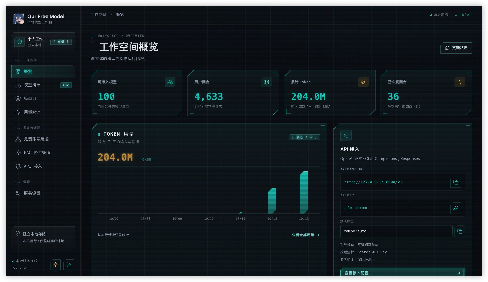
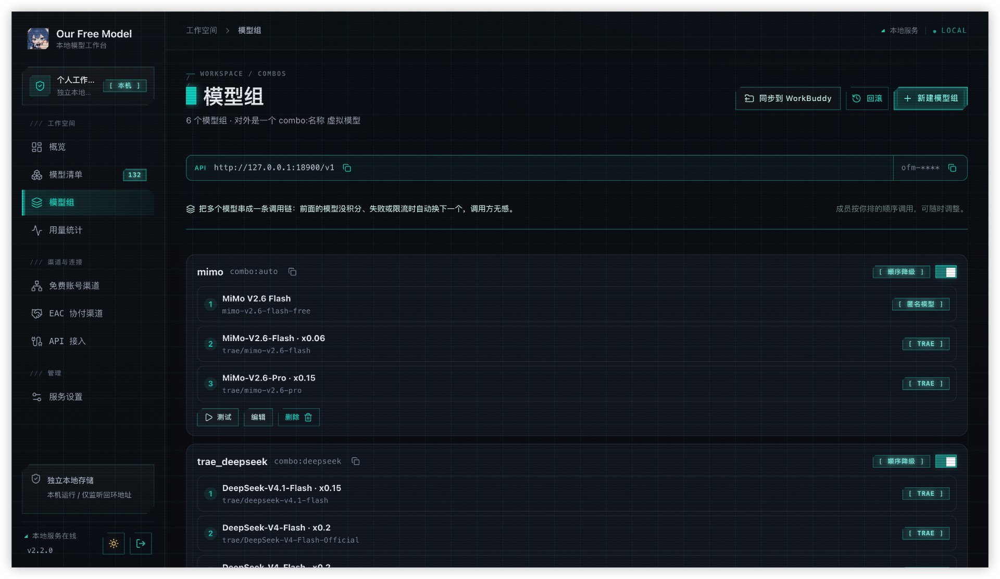

<div align="center">
  

# dsh-our-free-model · fork

**这是 [`Ebony-Vinyl/dsh-our-free-model`](https://github.com/Ebony-Vinyl/dsh-our-free-model) 的个人 fork。**

  
  
  
  
  

</div>

---

## 关于这个 fork

> **原项目的一切功能、原理、上游来源与详细文档，请以原仓库为准：**
> **[github.com/Ebony-Vinyl/dsh-our-free-model](https://github.com/Ebony-Vinyl/dsh-our-free-model)**
>
> 本仓库是它的个人 fork，**只做增量增强，不重复原项目文档**。装插件、用免费模型、
> 看渠道原理、查排障手册——都请去原仓库。这里只说明「本 fork 在原项目之上多做了什么」。

---

## 你会看到什么

**独立本地控制台首页**

<div align="center">
  
  <br>
  <sub>独立本地服务控制台首页：概览卡片、Token 用量趋势、API 接入信息条（地址 + 打码 Key + 默认模型）、左侧完整导航</sub>
</div>

独立控制台共八个页面：**概览**、**模型清单**、**模型组**（本 fork 新增）、**用量统计**、
**免费账号渠道**、**EAC 协付渠道**、**服务设置**、**API 接入**。默认夜间主题（夜·赛博终端）。

**DSH 插件形态下的模型选择器**

| 分组 | 内容 |
| --- | --- |
| Our Free Model | 当前网络出口可直接使用的模型 |
| Our Free Model · region-limited | 上游对该地区不放行的模型，保留可见但单独隔离 |

被判定为「已声明但不路由」的模型不出现在任何分组中——仅在设置页的「不在选择器中」分组保留记录，
附带拒因与探测时间；后续探测重新通过后自动回到选择器。

---

## 本 fork 的增强

以下 8 项是相对上游的**净增量**（`git diff ddb451c..HEAD`：51 个文件，+2504 / -108 行）。

### 1. 模型组（combo）配置入口 —— 本 fork 的核心新增

原项目的降级链（combo）只能通过配置文件手写；本 fork 把它做成了**完整的可视化配置页**。

<div align="center">
  
  <br>
  <sub>模型组配置页：每条链一张卡片，成员按调用顺序排列（可上下移）、标注来源渠道与倍率，<br>
  支持测试 / 编辑 / 删除 / 启停，页头提供「同步到 WorkBuddy」与「回滚」入口</sub>
</div>

- 新增独立控制台「**模型组**」页（`packages/standalone/frontend/combos.tsx`，330 行）：
  新建 / 编辑 / 删除 / 启停 / 测试，勾选模型、上下移调整调用顺序
- 新增管理接口：`GET/POST /api/management/combos`、`POST /api/management/combos/delete`
- combo 虚拟行改由 **service 层现算**（核心车道 + 账号渠道合并），因此**成员可以跨渠道组队**：
  免费车道模型 + 账号渠道模型可以串进同一条链，由各自的 Worker 真实推理
- 复用适配器的 `commitsAnswer` 提交规则：**输出正文之前**整条候选可被无声丢弃并换下一个，
  一旦开始产出就绝不拼接
- **模型组支持中文命名**：`深度求索` → `combo:深度求索`（`src/combos.js` 用 `\p{Letter}` 按字保留）
- 两种策略：`顺序降级`（fallback）与 `轮询分流`（round-robin，连续 N 轮粘滞）

### 2. WorkBuddy 配置同步 —— 本 fork 独有

把本服务的模型组与单模型**一键写进 WorkBuddy 的模型配置**，让 WorkBuddy 直接以 OpenAI 兼容方式调用本地网关。

- 新增 `packages/standalone/workbuddy-sync.mjs`（342 行），写入 `~/.workbuddy/models.json`
- **提交管线安全**：tmp 写成功 → 原文备份到 `models.json.backups/`（保留 20 份）→ rename 原子替换；
  非法 JSON / 顶层非数组一律拒绝写入并明确报错，绝不覆盖
- **归属判定**：只管理 `url` 为回环地址且 `apiKey` 以 `ofm-` 开头的条目（兼容旧 `combo:` 前缀）；
  单模型条目「刷新但不清理」，避免误删用户手工写入的配置
- 新增 4 条路由：`/combos/export-workbuddy`、`/models/export-workbuddy`、`/workbuddy/backups`、
  `/workbuddy/backups/restore`
- 前端：模型组页「同步到 WorkBuddy」+ 回滚面板（两段式确认）；模型清单页每行「写入 WorkBuddy」按钮
- 配套离线单测 `workbuddy-sync.test.mjs`（26 项，临时目录注入，不触碰真实配置）

### 3. 接入地址来源切换 + 接入信息条

- 接入地址可选「**当前访问的域名 / 本机 127.0.0.1**」，选择持久化并跨页生效
  （`frontend/endpoint-origin.ts`）
- 新增「**接入信息条**」（`components/endpoint-strip.tsx`）：左段完整 API 地址、右段打码 Key，
  各自独立复制反馈；Key 明文只在点击瞬间取出写入剪贴板，**永不进 state / render**
- 概览页新增默认接入模型选择与复制（记住上次选择，优先模型组，再退首个可接入模型）
- 原「整段 JSON 配置复制」撤掉，改为分项复制按钮

### 4. 本机令牌自动登录 + 反向代理识别

- 新增免鉴权路由 `GET /api/management/local-key`：登录页自动读取本机令牌并直接登录，
  省去翻文件、复制、粘贴的整套步骤
- **双层反代判据**，确保经反向代理部署时不会误放：
  ① 显式部署声明 `OFM_BEHIND_PROXY=1`（本机令牌自动登录整体关闭，一律手动填 Key）；
  ② 转发头兜底 `X-Forwarded-For / X-Real-IP / X-Forwarded-Proto` 任一存在即拒绝
- 另保留 `sec-fetch-site=same-origin` 与回环 Host 两道保险（防 DNS rebinding）
- 主动退出后不自动登回（`loggedOut` 标记）

### 5. 模型清单改版 + 账号渠道真实探测

- 快捷标签改为**五个互斥视图**：全部模型 / 已探测可用 / 可接入 / 未公开 / **已关闭**；
  页面默认选中「已探测可用」
- 新增**单模型启停**：关闭的模型从公开清单、推理路由、组合链与探测中统一剔除，
  但保留在「已关闭」页可随时重新开启
- 新增 `packages/standalone/channel-probe.mjs`（80 行）：修复账号渠道模型永远显示「清单已收录」的问题
  ——改走渠道真实推理路径做最小探测（`max_tokens 16`、并发 2），判定写回共享 availability 存储，
  沿用核心探测的非对称哲学（无错误→available、404→unavailable、429→throttled、其余→unknown 不移动状态）

### 6. 管理页默认夜间主题

`frontend/theme.mjs`：默认使用夜间主题（夜·赛博终端），仅在用户手动切换过时才沿用其选择。

### 7. macOS 桌面壳

- `tauri.conf.json`：打包目标加 `dmg`，`minimumSystemVersion: 11.0`
- `lib.rs`：macOS 菜单栏（Cmd+Q / 编辑菜单走系统实现）、Dock 图标唤回窗口、自绘标题栏适配
- `PACKAGING.md` 新增「macOS 桌面构建」一节，含产物路径、签名现状与 Gatekeeper 处理说明
- 桌面壳与独立服务共用同一套服务端，不是另起一套实现

### 8. 双平台 CI 出包

新增 `.github/workflows/desktop-build.yml`（152 行）：

- **Windows** runner 构建 NSIS 安装包（`*-setup.exe`）
- **macOS** runner 构建 DMG（`*.dmg`）
- Tauri 不能交叉编译，因此两平台各用自己的 runner；内置 Node 与构建机平台架构一致
- 手动触发（`workflow_dispatch`），可选 `draft_release` 把两个安装包一起发到 GitHub Release
- 触发方式：`gh workflow run desktop-build.yml --repo XuePengJu/dsh-our-free-model --ref master`

---

## 独立本地服务（本 fork 的主要形态）

原项目的 README 把「独立本地服务」标注为「开发中」；本 fork 把它作为**主要使用形态**继续推进。

从完整源码仓库运行：

```bash
npm run start:standalone
```

- 默认数据目录 `~/.our-free-model`，默认端口 `18900`
- 拥有自己的 API Key，不读取插件数据（`DSH_HOME` 与 `OFM_HOME` 默认互不影响）
- 提供 Chat Completions、Responses API，以及独立网页管理
- 启动后打开终端打印的**一次性管理链接**即可使用（10 分钟内有效、仅能兑换一次）
- 支持匿名 / Kilo 免费车道、EAC 协付与原有十三个账号渠道

启动、参数、鉴权与验证细节见 **[独立服务说明](packages/standalone/README.md)**。

> 桌面壳（Windows / macOS）是独立服务的另一种启动方式，复用同一套渠道、管理 API 与前端。
> 构建方法见 [PACKAGING.md](PACKAGING.md)。

---

## 安装

### 独立服务 / 桌面端（推荐）

见上一节，以及 [PACKAGING.md](PACKAGING.md) 的构建说明。

### DSH 插件形态

```
dsh plugin --profile web add /绝对路径/dsh-our-free-model
```

安装完成后重启应用一次。`--profile` 填写实际使用的 profile 名称。

> **插件形态的完整安装说明、桌面端 profile 闸门、各类安装失败排障
> （`ERR_PNPM_VIRTUAL_STORE_DIR_MAX_LENGTH_DIFF`、`git ls-remote`、
> `profile "desktop" is managed exclusively by the Electron application` 等），
> 请见[原项目 README 的「安装」一节](https://github.com/Ebony-Vinyl/dsh-our-free-model#安装)。**

---

## 使用说明

**选择模型**：打开输入框的模型选择器，选择 Our Free Model 分组下的任意模型。选择结果按会话持久化。

**调整思考强度**：同一菜单中的 Effort，共三档 Light / Balanced / Deep。档位越高，思考占用的
输出预算越多；上限为强制下发，因此档位之间存在可测量的差异。思考与可见回答共享同一输出额度，
因此思考不可关闭的模型会将三档整体上移（设置页的模型卡上标注了每档的实际数值）。

**供本机其它工具调用**：服务设置 → API 接入，启用后复制 base URL 并生成 Key。支持：

- `GET /v1/models`
- `POST /v1/chat/completions`（流式与非流式）
- `POST /v1/responses`（流式与非流式）
- `POST /v1/messages`（流式与非流式，Anthropic Messages）
- `POST /v1/messages/count_tokens`（本地估算，不含 tokenizer）

**写入 WorkBuddy**：模型组页「同步到 WorkBuddy」全量写入并清理残留；模型清单页每行「写入 WorkBuddy」
单条写入。两者都会先备份 `~/.workbuddy/models.json`，可在模型组页的回滚面板恢复。**重启 WorkBuddy 后生效。**

**升级**：插件形态支持设置页一键升级（下载 → 校验 → 备份 → 替换 → 热重载，失败自动回滚）。

> 端口占用顺延、局域网转发、公告接收、Gemini 与 Cline 的代理连接等完整使用说明，
> 见[原项目 README 的「使用说明」一节](https://github.com/Ebony-Vinyl/dsh-our-free-model#使用说明)。

---

## 原项目能力速览

以下能力**全部来自原项目**，本 fork 未做改动；详细原理与配置请查阅原仓库。

| 能力 | 一句话 |
| --- | --- |
| 免费车道 | OpenCode Zen 网关 + Kilo AI 公共网关，直连不经中转，清单跟随上游实时刷新 |
| 账号渠道 | CodeArts、CodeBuddy / WorkBuddy、LobsterAI、Qoder、TRAE、Cline、Loomy、Raccoon、MiniMax Code、ZCode、Gemini 等十三个渠道，含登录 / 账号池 / 每日积分领取 |
| EAC 渠道 | 桌面端专属协付通道，凭据 AES-256-GCM 密封，需 GitHub 登录 + star 仓库解锁 |
| 聚合渠道 | 内置 76 家提供商注册表，自带 Key 即可把第三方模型接进同一条清单 |
| 本地网关 | 兼容 OpenAI 与 Anthropic（`/v1/messages`），可给本机其它工具与局域网设备调用 |
| 省 Token | 工具输出压缩（RTK，实测 40 KB 的 `git diff` 省 90% 字节）、提示词瘦身、五个本地应答 |
| 路由 | `combo:<name>` 命名降级链（本 fork 补上了可视化配置页，见上文） |
| 其它 | 公告中心与实时推送、应用内升级（Ed25519 签名 + SHA-256 + 自动回滚）、热重载、用量看板 |

---

## 实现结构

```
index.js                    Host 半身：适配器注册、清单与可用性探测、设置/用量存储、
                            webServer 路由、转发端口生命周期、公告/升级/热重载接线
adapter/                    内核接缝：全包唯一允许 import @deepseek-ai/* 的位置
src/adapter.js              结构性 LlmAdapter：providerInfo、listModels、resolveModel、
                            prepareCall、stream、providerRetryPolicy
src/upstream.js             网关身份：凭据、session/request id 铸造、工具指纹、按线协议选端点
src/stream.js               三种线协议解码（chat / messages / responses）归一为 harness StreamChunk
src/messages.js             harness 消息 -> 各线协议形态，外加工具调用配对修复
src/effort.js               思考档位 -> 输出预算
src/forward.js              独立的 OpenAI 兼容监听器（另含 Anthropic Messages 端点）
src/providers/registry.json 聚合车道注册表：76 家提供商的分类、认证、线协议与端点
src/aggregate.js            聚合车道：清单行、凭据解析、Key 脱敏、列表探测
src/anthropic.js            /v1/messages 的 Anthropic Messages 编解码与本地 token 估算
src/token-saver/            压缩管线：提示词注入 -> 工具输出压缩，按字节留痕、失败开放
src/local-optimize.js       五个本地应答：额度探测、命令前缀、会话标题、建议模式、文件路径
src/combos.js               降级链：虚拟清单行、两种策略、容量取交集（本 fork 改为支持中文命名）
src/trust.js                插件路由的请求信任围栏（connection 服务桥 + 结构化围栏）
src/push.js                 SSE 推送枢纽：公告到达、更新可用、升级完成
src/feed.js                 远程公告 feed：多源拉取、校验、缓存、到达检测
src/updater.js              应用内升级：清单校验、SHA-256 分级校验、备份、原子替换、回滚
src/reload.js               自热重载：镜像内核 HMR 的缓存清除 + 重导入 + 重注册 + 回滚序列
client.js                   浏览器半身：手写 ModuleLoader bundle，无构建步骤

packages/standalone/        独立本地服务（本 fork 主推形态）
  service.mjs               服务入口：HTTP 挂载、渠道运行时、combo 现算与链式分流
  management.mjs            管理接口：会话、设置、模型、密钥、模型组、WorkBuddy 导出
  workbuddy-sync.mjs        WorkBuddy 配置同步（本 fork 新增）
  channel-probe.mjs         账号渠道模型可用性探测（本 fork 新增）
  frontend/                 前端源码（React + TypeScript）
  web/                      前端构建产物（提交入库，服务直接载入）

packages/desktop/           Tauri 桌面壳（Windows NSIS + macOS DMG，本 fork 补齐 macOS）
```

> 几个值得了解的架构决定（一个适配器两条 provider 路由、以结构化方式实现适配器、
> 使用自有 JSON 存储、Token 压缩跑在唯一收口上、combo 是虚拟清单行）见
> [原项目 README 的「实现结构」一节](https://github.com/Ebony-Vinyl/dsh-our-free-model#实现结构)。

---

## 已知边界

「不限量」指不存在额度体系：无需充值、不按 token 计费、没有套餐与用量面板。但免费车道按 session
统计速率，短时间内打满会返回 429。服务将该模型标记为「已达限额」，不做隐藏，下一轮探测自动恢复。

思考过程为静默等待，且与正文共享输出预算。实测 `mimo-v2.6-flash-free` 可在思考阶段静默 60–70 秒，
期间上游计费 3024 个 reasoning token 但不发送任何思考帧；此类回合会以 stop 收尾而正文为空，
客户端容易报告「空响应」。预算只能由调用方给出：将单次输出上限提升至 16k 以上，
或改用模型卡中标注 `reasoning: false` 的模型。

输出速度有时会显示 —。答案集中在一两个大帧中落地、或思考过程根本不流式返回的模型，
不存在可用于计算的时间窗。看板宁可留空，也不会将「思考耗时」计入「输出速度」。

自动恢复存在次数、时间与上下文边界。仅恢复纯思考 EOF 与纯思考空停（正常 stop 收尾但无正文），
最多追加一次请求；已输出正文、工具调用、用户取消与明确错误不触发恢复。该机制基于检查点重新发起请求，
无法保留上游未发出的内部状态，且不保证成功。缺失 usage 时的用量仅为已知部分。

能力标注以探测可证明者为限。公开清单与实测均无法取得证据的，不予标注。

源码为明文 JavaScript。作为本地插件必须如此。能够访问该目录的人员即可读懂网关逻辑——
请将其视为该分发形态的固有属性，混淆无法解决该问题。

桌面端安装需要真实目录，原因见原项目安装一节。

升级与热重载的信任边界：应用内升级的信任根为插件内 pin 的 Ed25519 公钥，不再依赖「HTTPS 到仓库」
——清单必须携带发布私钥签名方可安装，镜像被投毒只会导致升级失败，不会执行其中的代码。
文件层面的完整性由签名与 SHA-256 清单双重保障，代码层面的安全由客户端白名单 HTML 渲染器
与宿主的插件隔离承担。

独立服务与插件的数据目录默认互不影响，**不要主动把独立服务的 `OFM_HOME` 指向插件的数据目录**。
同一个数据目录只能启动一个独立服务实例。

---

## 开发

```bash
npm test                        # 全部离线套件 + 清单一致性检查，一条命令
npm run typecheck               # tsc --noEmit，严格检查 adapter/ 接缝
node scripts/client-lint.mjs    # 浏览器半身：文案键与样式键双向覆盖、bundle 可执行

# 独立服务
npm run start:standalone        # 启动独立本地服务
npm run test:standalone         # 独立服务专项测试（本机 HTTP 替身，不出网）
npm run test:management         # 管理接口专项测试
npm run test:standalone-channels
npm run typecheck:standalone
npm run build:standalone-ui     # 重新构建独立控制台前端
npm run build:standalone-channels
```

独立控制台前端为 **React + TypeScript**：`frontend/` 是源码，`web/` 是提交的构建输出。
修改前端后需重新构建并重启服务。开发工具只用于构建，不作为网页资源公开。

需要 Node `^22.19.0 || >=24.0.0`。插件形态无安装步骤、无依赖。

> 完整测试套件清单（retry-safety、speed-stat、sanitize、trust、feed、updater、effort、
> sniff、release-e2e、picker、tui、host-selftest 等）与发布签名流程，
> 见[原项目 README 的「开发」一节](https://github.com/Ebony-Vinyl/dsh-our-free-model#开发)。

---

## 上游是哪些源

**以下内容完全属于原项目**，本 fork 未改变任何出网目标。两条公开免密来源均直连、不经第三方中转；
另有自建网关为 EAC 渠道。

**免费车道：OpenCode 的 Zen 网关，`https://opencode.ai/zen/v1/*`**

| 用途 | 目标 | 凭据 |
| --- | --- | --- |
| 推理请求 | `POST …/zen/v1/chat/completions`、`…/zen/v1/responses`、`…/zen/v1/messages` | `Authorization: Bearer public`——该车道本身即为公开免密额度 |
| 模型清单 | `GET …/zen/v1/models` | 同上 |
| 公告与升级清单 | 本仓库的 `feed/*.json`：raw.githubusercontent.com 优先，cdn.jsdelivr.net 兜底 | 无 |
| 出口地区判定 | api.ipify.org / ipinfo.io / ipapi.co，仅读取本机公网 IP 与国家码 | 无 |

**Kilo 渠道：Kilo AI 的公共网关，`https://api.kilo.ai/api/gateway`**

| 用途 | 目标 | 凭据 |
| --- | --- | --- |
| 推理请求 | `POST …/api/gateway/chat/completions`（OpenAI Chat Completions 兼容，SSE 流式） | **无**——免费池（`isFree: true`，含 `kilo-auto/free`）不需账号、Key 或登录态 |
| 模型清单 | `GET …/api/gateway/models` | 无 |

没有号池、没有中转、没有二道贩子。`npm test` 的离线套件完全不出网；仅 `host-selftest.mjs`
与 `scripts/probes/` 会主动请求这些地址，且需手动运行。

你的 prompt、工具结果与随附图像会作为正常推理请求发送至所选模型对应的上游——与调用任何模型 API 相同。
除此之外不上传任何内容：用量看板数据、设置、转发 Key 均只落在本机数据目录。

免密不等于无人管理：免费车道通过 `x-opencode-*` 指纹识别客户端、按会话统计免费额度，
会因地区返回 403、因超量返回 429。**Kilo 免费池在其模型卡中明确声明：prompt 可能被上游提供方记录，
并用于改进其服务**（原文见 `kilo-auto/free` 模型卡）。模型集合与额度政策由上游决定，随时可能变更。

---

## 免责声明

- **本项目是客户端，不是模型服务方。** 所有模型响应均由上述第三方上游生成并传输；不托管、
  不修改、不过滤任何模型输出。模型可能产出错误、过时或有偏颇的内容，请自行核实后再使用。
- **免费不等于无限，也不等于私有。** 免费额度由上游单方面提供，随时可能限流、收费或下线；
  Kilo 免费池明确声明 prompt 可能被上游记录并用于改进服务。**请勿通过免费车道发送密码、密钥、
  个人身份信息、商业机密或任何你不愿第三方处理的内容**；生产与敏感场景请使用自己的付费 API。
- **上游条款由你遵守。** 使用各渠道即表示你同意对应上游的服务条款与用量政策；
  因违反上游政策导致的限流、封禁或其它后果由使用者自行承担。
- **EAC 渠道为协付性质。** 该渠道的凭据与网关由**原仓库维护者**部署，仅限授权用户使用；
  请勿尝试绕过授权闸门，勿转售或共享渠道访问权。
- **本项目与上述任何上游厂商无隶属或背书关系。** 各厂商名称与商标归其各自所有者所有，
  仅在说明来源时引用。

---

## 安全与隐私

所有状态写入本服务自己的数据目录（独立服务默认 `~/.our-free-model`，插件形态为
`DSH_HOME/our-free-model`）；用量与设置仅落在本机，不上传至任何位置。

聚合车道的 Key 同样不出本机：只写入 0600 权限的 `settings.json`，请求只发往你自己配置的那家提供商，
接口只回显 `hasKey` 与 `…abcd` 指纹，从不回显 Key 本身。

**WorkBuddy 同步的写入安全性**（本 fork 新增）：只写 `~/.workbuddy/models.json`，
写前先 tmp 校验 → 备份原文（保留 20 份）→ rename 原子替换；非法 JSON / 顶层非数组一律拒绝写入。
备份文件名走白名单正则，天然杜绝路径穿越；回滚本身也可回滚。

转发监听仅绑定回环地址，默认 `127.0.0.1`，无 Key 请求一律拒绝。将地址改为可路由接口会被直接拒绝。

局域网访问是另开的一扇门，并不放宽上述规则：需显式启用「局域网访问」，中继绑定可路由地址，
每个请求都需携带独立的局域网 Key，仅转发白名单路径，入口处把局域网 Key 换为本机 Key，
携带跳数标记的请求直接拒绝（防自环）。

公告 HTML 在客户端经严格白名单渲染，不经过任何 `innerHTML` sink。

应用内升级的完整性链：清单 Ed25519 签名验证（公钥 pin 在 `src/updater.js`）→ 清单校验
（semver、路径逃逸、哈希格式）→ 下载时逐文件校验 SHA-256 与字节数 → staging 回读校验 →
安装后回读校验 → 任一步失败即恢复备份。

> 完整的信任围栏说明、转发 Key 机制、更新通道与 feedUrl 解耦细节，
> 见[原项目 README 的「安全与隐私」一节](https://github.com/Ebony-Vinyl/dsh-our-free-model#安全与隐私)。

---

## 许可证

MIT，见 [LICENSE](LICENSE)。

本项目为独立插件，与任何模型提供方无隶属、认可或赞助关系。使用本项目访问免费额度受各提供方
自身条款约束；在超出个人机器的场景中部署前，请先确认这些条款。

---

## 来源与许可

本仓库是 **[Ebony-Vinyl/dsh-our-free-model](https://github.com/Ebony-Vinyl/dsh-our-free-model)**
的 fork，基于上游 `ddb451c`（2026-10-12）分叉，在其之上叠加本 fork 的增量增强。

- 原项目采用 **MIT 协议**，`LICENSE` 文件中的
  `Copyright (c) 2026 Ebony-Vinyl` **完整保留、未做修改**——这是 MIT 协议的要求，
  也是本项目合规的基础。本 fork 不对原作者的代码重新许可。
- 原项目的功能、原理、上游来源、验收记录与全部细节文档，请以**原仓库**为准。
- 本 fork 新增代码同样以 MIT 协议发布。

如需把本 fork 的增强回流上游，欢迎向上游提 PR。
