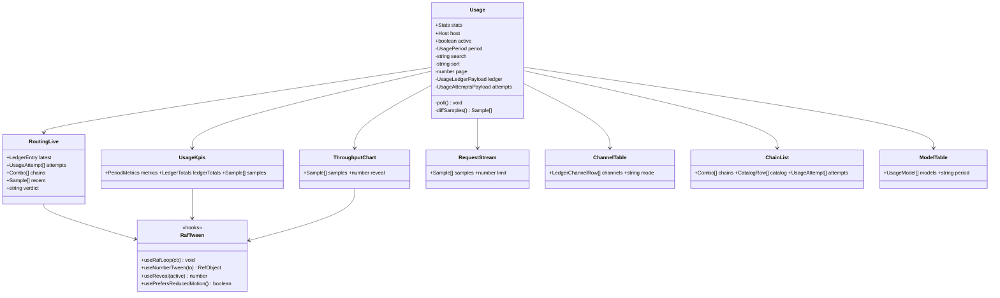
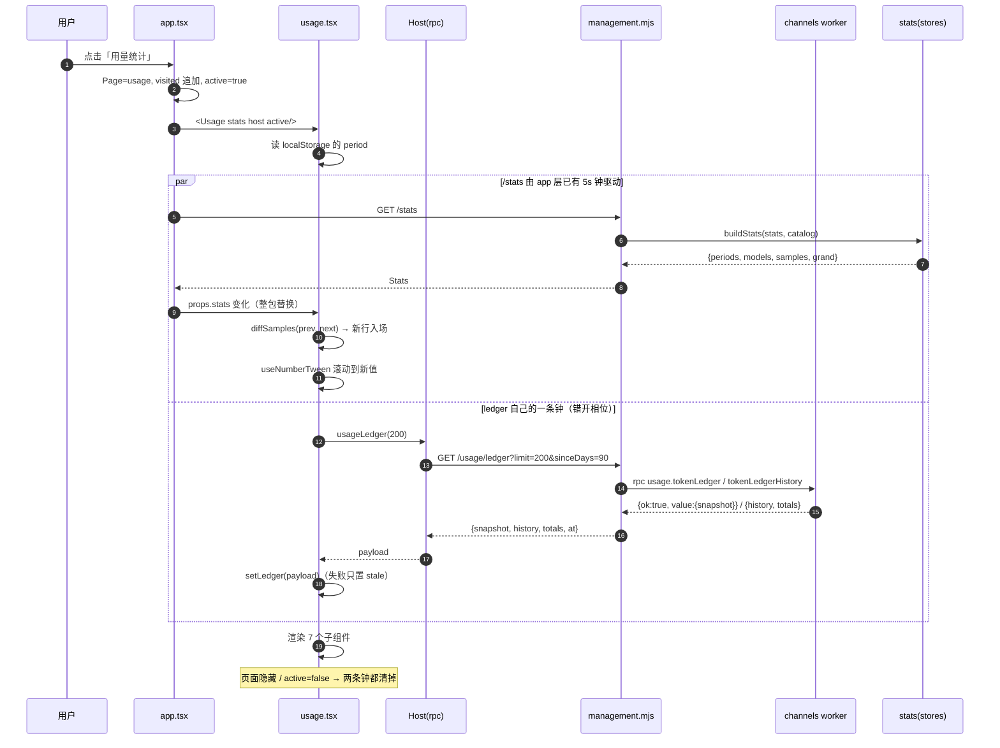
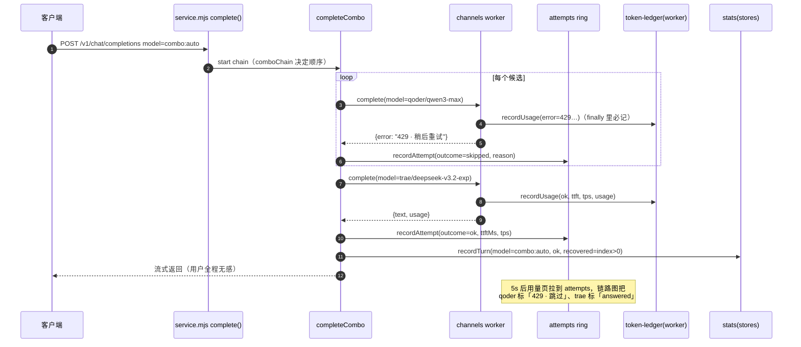
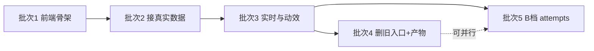

# 用量统计页 × 渠道用量页 融合改造 —— 架构与实施任务分解

> 视觉与交互基准：`docs/design/usage-routing.html`（已定稿，本文不重新设计视觉，只做工程化落地）
> 作者：高见远（架构师） · 状态：待评审 · 本阶段**只出方案，不改业务代码**

---

## 1. 结论摘要

**一句话**：把「用量统计」页重写成一块双源融合看板（`/stats` 供业务口径 + `usage.tokenLedger` 供渠道/账号口径），新增 3 个后端只读端点、重写 1 个页面为 7 个子组件、删除渠道页的「渠道用量」入口；**走 B 档已确认**（记录真实 `attempts[]`），因为经核实 B 档的成本比预期低一个数量级——降级链的 walk 逻辑不在 vendor，而在本仓 `src/adapter.js` 与 `packages/standalone/service.mjs` 两处纯 ESM 源码里，**不需要改 vendor、不需要重打包 `business.mjs`**。

| 决策点 | 结论 |
|---|---|
| 数据源 | 三源：`/stats`（业务/趋势/实时流）+ ledger（渠道/账号/速度/缓存）+ `attempts`（路由结果） |
| 实施档位 | **B 档（老板已确认）**，拆成 5 个批次，B 档的 `attempts` 放在最后一批，可独立回滚 |
| 实时通道 | **不新增 SSE**，保留 5s 轮询 + 「快照差集驱动入场动画」 |
| 页面拆分 | `usage.tsx` 只做编排，7 个子组件 + 3 个 hook + 1 个新 CSS 文件 |
| 页面改名 | **改为「用量与路由」（老板已确认）**：批次 1 直接写新 `h1`，`shell.tsx`/测试留批次 4 |
| KPI 数量 | **固定 5 张（老板已确认）**，累计并入第 1 张副行，不做第 6 张卡 |
| 导出 CSV | **不渲染该按钮（老板已否决最小实现）**，见 §11 决策记录 3 |
| 旧入口 | 渠道页 `tools` 数组删除 `ledger` 项，`LedgerPage` 解构与分支一并清理 |
| 构建产物 | `packages/standalone/web/` 已入库（`git ls-files` 可证），**必须重建并提交** |

---

## 2. 现状核实（含对任务书的两处修正）

任务书里的事实我已逐条比对源码，绝大部分准确。两处必须修正，因为它们直接改变 B 档的成本判断：

### 修正 1：降级链不在 vendor，在本仓

任务书假设「B 档要在 `vendor/channel-pack/src/openai-gateway/` 增加 `attempts[]` + 重新打包」。实际不是：

| 链路 | 代码位置 | 是否 walk 候选链 |
|---|---|---|
| dsh 宿主插件推理 | `src/adapter.js#runCombo`（223–284 行） | ✅ 是，已有 `tried[]` 与 `index` |
| 独立端本地网关推理 | `packages/standalone/service.mjs#completeCombo`（271–304 行） | ✅ 是，已有 `index` 与 `last.error` |
| vendor `openai-gateway` | `vendor/channel-pack/src/openai-gateway/*` | ❌ 只做**单次**调用的 provider/model/account 解析 |

两处都是本仓的普通 ESM 源码，改完即生效，**零打包**。vendor 侧唯一相关的是 `token-ledger.ts`（记账），而 B 档**不改** ledger entry 结构（理由见 §4.3）。

### 修正 2：`/stats` 的 `samples` 比任务书描述的更丰富，但仍缺两个维度

`src/store.js#recordUsage`（335–407 行）写进 `samples` 的字段实际是：

```js
{ at, model, ok, input, output, ttftMs, tps, decodeMs, decodeTokens, effort, origin,
  truncated?, noUsage?, recoveryId?, attempt?, elapsedMs?, recoveryAttempt?, recoveryScheduled?, recovered?, aborted?, ...savings }
```

环形保留 400 条，`buildStats` 下发最后 200 条。**缺**：`provider`、`accountId`、`channel`。其中 `provider` 可由 `model` 派生（模型 id 形如 `qoder/qwen3-max`，`combo:xxx` 除外），`accountId` 无法派生——这是 A 档必须降级、B 档才能补齐的那个点。

另一个易踩的口径坑：`adapter.js` 的 `record()` 里 `attempt` 字段是 **`runSingle` 内部的 recovery attempt（0/1）**，不是 combo 的候选序号。任务书里"降级接管"想读 `samples.attempt` 是读不到候选序号的。

### 其余核实结论（直接采信）

- `/stats` 响应确实**只有 model 维度**，无 channel/account（`src/core/stats.js` 全文 107 行已读）。
- ledger entry 冻结字段、`TOKEN_LEDGER_LIMIT = 500`、`readTokenLedger` 的四级聚合树、「均值用 Σ/份数」——与任务书一致（`vendor/channel-pack/src/token-ledger.ts`）。
- ledger **不是"重启即空"**：`configureEntryLog` → `restoreLedgerFromEntryLog()` 会从 `request-log-YYYY-MM-DD.jsonl` 回读最近 500 条（剥离全文）。任务书风险项里的"重启后空"应修正为"回读失败/首次启动时为空"。
- 渠道 RPC 跑在 **worker 线程**（`packages/standalone/channels/runtime.mjs`），管理端通过 `channels.rpc(body, signal)` 跨线程调用，超时 10 分钟。
- `LedgerPage` 源码在 `client.js:5023–5150`（`client.js` 是打包产物，`scripts/lib/standalone-shared-ui.mjs` 在构建时把它转成 `ofm-shared-client`）。**没有"聚合树展开"交互**：它是把四级树**摊平成三张表**（最近明细 / 账号 / 模型）。也**没有导出/CSV**。
- `scripts/standalone-react-ui-test.mjs` 已对 `usage.tokenLedger` 做了 `{entries: []}` 桩（第 71 行），融合改造不需要给测试补新桩，但 `usage-ready` 等 testid 与渠道页菜单断言会受影响（见 §12）。

---

## 3. 数据源方案（本文最重要的判断）

### 3.1 三源分工

```
                    ┌─────────────────────────────────────────┐
GET /stats  ───────▶│ 业务口径：回合 / 物理请求 / 周期聚合 / 趋势 │
（已有，不动）        │ + samples → 实时请求流                    │
                    └─────────────────────────────────────────┘
                    ┌─────────────────────────────────────────┐
GET /usage/ledger ─▶│ 渠道口径：channel→provider→account→model  │
（新增，薄封装）      │ + 速度 / 首字 / 缓存 / 失败 / tok/s       │
                    └─────────────────────────────────────────┘
                    ┌─────────────────────────────────────────┐
GET /usage/attempts▶│ 路由口径：谁被跳过、谁接管、错误原文        │
（新增，B 档）        │ （A 档缺失此源，降级为"配置 + 最近一次命中"）│
                    └─────────────────────────────────────────┘
```

**为什么不让 `/stats` 承担一切**：`stats` 的聚合键是 `model`，加 `provider/account` 维度等于重写 `recordUsage` 的日桶结构与 `buildUsagePeriods` 的口径铁律（见该文件头注释），并让既有 `/stats` 消费者（概览页、模型页、三个 e2e）全部受影响。而 ledger 已经是「channel→provider→account→model」四维，直接可用。**同一个看板两个口径并存，用标注区分，是这里唯一可接受的方案。**

**为什么不让 ledger 承担一切**：ledger 只有「物理请求」，没有「用户回合」；没有「周期聚合」（只有今日内存 + 90 天日桶）；没有 `turns/failedTurns/recoveredTurns`。原型的 KPI 与趋势图必须走 `/stats`。

### 3.2 逐区块的数据来源

| 原型区块 | 数据源 | 落地说明 |
|---|---|---|
| 路由实况：调用来源卡 | `/stats` + `combos` | 来源 = 最近 5 分钟活跃的 `combo:` / 直连模型，来自 `samples` 去重 |
| 路由实况：候选链（渠道·模型·账号·tok/s·状态） | **A**：combo 配置 + ledger 最近一条命中<br>**B**：`/usage/attempts` | 见 §4 |
| 本次请求条（请求号·命中·首字·tok/s·输出量） | `ledger.entries[0]` | 首次进入时取最新一条，之后由轮询差集更新 |
| 裁决一句话 | 由 `attempts`（B）或 `entry.error`（A）推导 | 文案模板在 `usage-data.mjs`，不进组件 |
| 三个大数字 | `/stats` + `samples` | 见下 §3.3 口径表 |
| 5 张 KPI | `/stats` + ledger totals | 双源各取所长 |
| 双轴图（面积=token，虚线=tok/s） | `/stats` 的 `periods[day].chart.bars` + `samples` 分桶 | 见下 |
| 实时请求流 | `samples`（200 条） | 派生 `provider`，无账号 |
| 渠道·账号明细表 | `usage.tokenLedger` 树摊平 | 见 §3.4 |
| 降级链清单 | `GET /combos`（已有） + `summary.catalog` | 无需新接口 |

### 3.3 双轴图的数据来源（原型的"近 60 分钟"）

`/stats` 的 `periods[day].chart.bars` 只有 1 根（今日）；`periods[all].chart.bars` 是月粒度。**都不够画 60 分钟**。

方案：**用 `samples` 在客户端分桶**（每 2 分钟一桶，30 桶）：

- 面积/token = 桶内 `input + output` 求和；
- 虚线 tok/s = 桶内 `tps` 的算术平均（跳过 `null`，与 ledger「只对有实测值的请求取均值」同口径）；
- 空桶画 0，但用 `gap` 语义（不连线）避免"看起来是 0 吞吐"的误读——这与 `decodeWindow` 的 `measurable` 精神一致。

`tps` 在 samples 里已经过 `MIN_DECODE_MS=250` / `MAX_CREDIBLE_TPS=250` 门槛（`src/store.js:312–329`），客户端**不要**再做二次裁剪，否则会重演"63 000 tok/s"那类事故。

如果 `samples` 条数不足以覆盖 60 分钟（< 30 条），图上给一行灰字「样本不足，仅显示最近 N 条」——不许用假数据补。

### 3.4 渠道·账号明细表

ledger 的 `snapshot.channels` 是四级树，前端需要摊平成两种视图（原型右上角的「按渠道 / 按模型」切换）：

- **按渠道**：`channel|provider` 一行，账号列取该行请求数最多的账号（或"3 个账号"），模型列取 token 最多的模型；
- **按模型**：跨账号聚合（复刻 `client.js` 的 `ledgerModelRows` 逻辑）。

摊平实现放 `frontend/usage-data.mjs`（纯函数，可单测），**不要**在组件里做。返回结构见 §7.3。

### 3.5 需要新增/扩展的接口（完整清单）

| 接口 | 档位 | 说明 |
|---|---|---|
| `GET /api/management/usage/ledger?limit&sinceDays` | A+B | 薄封装 `usage.tokenLedger` + `usage.tokenLedgerHistory`，**解掉 RPC 信封**直接返回 `{snapshot, history, totals}` |
| `GET /api/management/usage/attempts?limit` | B | 读 `src/core/attempts.js` 的环形缓冲 |
| `GET /stats` 扩展 `samples[].provider` | 建议**本次不做** | 前端从 `model` 前缀派生即可，零后端风险；等 B 档 attempts 上线后再评估是否需要 |
| `POST /api/management/channels/rpc` | 不动 | 渠道页与日志页继续用它 |

**为什么新端点不复用 `/channels/rpc`**：那条路径的响应是 `{ok, value}` 双层信封、超时 10 分钟、错误语义是"渠道操作失败"，而这两个新端点是**高频只读轮询**。给前端一个 `request()` 就能直接用的扁平结构，比在 `channels.mjs` 里再抄一份 rpc 上下文干净。渠道页 rpc 上下文（`makeRpcContext`）有 `hide()` 时 abort 的生命周期，用量页不能被它牵连。

### 3.6 关键判断：融合看板**不重复**日志页的逐条明细表

任务书让我明确回答这一点，结论是 **不重复**，并且这不是妥协而是更好的方案。四条理由，按分量排序：

1. **视觉已定稿，原型里就没有这张表**。`usage-routing.html` 从上到下是：路由实况 → 本次请求条 → 裁决 + 三大数字 → 5 张 KPI → 双轴图 + 实时流 → 渠道·账号明细 → 降级链。**没有 14 列逐条明细**。我的职责是工程化落地已评审的设计，不是往定稿里加一块它没有的东西——加了就得重新评审，而且会破坏首屏的信息密度节奏（原型刻意让"实时流 6 条 + 聚合表"承担不同粒度）。
2. **同一份数据三处渲染必然漂移**。`LedgerPage`（12 行、无分页）与 `LogsPage`（20 行/页、分页、10s 自动刷新、行点开 `LogDetail` 懒加载 `usage.tokenLedgerDetail`）已经是"摘要版 + 完整版"的分工。再在看板上做第三份，列定义、格式化函数（`fmtMs`/`fmtTps`/`fmtPct`）、失败徽章语义要维护三遍；哪天账本加一列（比如 `cacheWriteTokens` 已经在 entry 里但两张表都没显示），必然漏掉一处。
3. **逐条审计本来就属于日志页，而且日志页已经**更强**。分页、每页条数、自动刷新、全文懒加载——这三项看板都不该重做。看板的时间尺度是"分钟/小时"，日志页是"单条"。把审计放进看板等于让看板同时做两个时间尺度的事。
4. **原型已经给了正确的出口**。实时流的页脚写着「在请求日志里看全部 →」（`usage-routing.html:585`）。这就是定稿给出的"想看逐条怎么办"的答案，只需要把它接到 `host.navigate('logs')`。

**因此落地口径**：

| 粒度 | 归属 | 布局 |
|---|---|---|
| 最近 6 条（渠道 + 模型 + 账号 + tok/s + 首字 + token 数） | 融合看板的「实时请求」面板 | 原型 `stream-list` |
| 渠道 / 账号 / 模型三级聚合（请求、失败、速度、首字、输入输出、缓存命中、占比） | 融合看板的「渠道·账号明细」表 | 原型 `tbl-scroll` |
| 逐条全明细（14 列、分页、详情全文、自动刷新） | `logs` 页（不动） | 已有 |
| 导出 CSV | **不做**（老板已否决） | 工具栏只留 seg，**不渲染按钮** |

**唯一的补偿动作**：实时流的每一行**可点**，点了 `host.navigate('logs')`（**不带筛选参数**——`LogsPage` 目前 props 只有 `{t, ctx}`，加筛选是另一个任务，不在本次范围）。这样"看到一条可疑的 → 去日志页看全部"是两次点击，路径不断。

**这一点会在验收时被问到，提前说清**：改造后"打开用量页看不到逐条 14 列"是**有意的能力迁移**，不是丢失。迁移目标页是「请求日志」，入口在两处：左侧导航常驻 + 实时流页脚链接。


---

## 4. A / B 两档实施路径

### 4.1 A 档：不动后端

- 候选链按 `settings.combos[].models` 的顺序绘制（`/combos` 已有）；
- 「命中」= `ledger.entries[0]` 的 `provider/model` 与链成员匹配，该行高亮为 `active/done`；
- 其余成员标 `pending`（原型里的"待命"），**不显示"已跳过"**——因为我们不知道；
- 三个大数字里的「降级接管」用 `stats.recoveredTurns` 近似，并在 hint 里写「含断流恢复，不完全等于链路降级」；
- tok/s 用 ledger 的 `avgTps`（按 provider 聚合），与原型"每候选一行 tok/s"的语义一致（原型也是渠道级均值）。

**A 档的诚实边界**：`ledger.entries` 里出现 `error` 的条目**确实**包含部分失败尝试——`llm-register-compat.ts` 在 `finally` 里记账，一个失败的候选项如果走到了 adapter，就会留下一条 `error` 条目。但：

1. 只有走到 adapter 才记（429 在 adapter 之前被账号池拦下的不记）；
2. 无法归因到"哪条链的第几号成员"（entry 里没有 comboId / index）；
3. 5 秒轮询下，多条 entry 的时序拼接不可靠。

所以 A 档可以做「最近失败」列表，但**不能**做原型里的"Qoder 曾 429，被跳过"这种链内定位。

### 4.2 B 档：记录真实 attempts

在**两处** walk 循环各记一笔（不是在 vendor）：

```js
// src/adapter.js#runCombo —— 在 tried.push(...) 旁边
recordAttempt({
  ts: Date.now(), comboId: entry.id, index, total: candidates.length,
  candidateId: candidate.id, provider: providerOf(candidate.id), model: modelOf(candidate.id),
  outcome: 'skipped', reason: describeVerdict(result.verdict), elapsedMs: Date.now() - attemptStarted,
})
```

成功那条记 `outcome: 'ok'`，并把 `ttftMs / tps / usage` 带上（此时 `runSingle` 的 outcome 已在手上）。

`packages/standalone/service.mjs#completeCombo` 同样处理（那里 `last.error` 就是原因原文）。

环形缓冲 200 条，放在**新增的** `src/core/attempts.js`：

- 模块级单例（与 `token-ledger.ts` 同一取舍：高频写、进程内存、重启即空）；
- `recordAttempt` **绝不抛错**（它在推理关键路径上，与 `recordTokenUsage` 同一条铁律）；
- 提供 `readAttempts({limit})` 与 `resetAttemptsForTests()`。

### 4.3 为什么 attempts 不写进 ledger entry

ledger entry 会 `JSON.stringify` 进 `request-log-YYYY-MM-DD.jsonl`，单条已中位 345KB（全文场景）。加 `attempts[]` 会让每行再涨几百字节到几 KB，且 `readTokenLedger` 是**每次快照都全量重建聚合树**（500 条 × 每条 attempts）。更关键的是：ledger 的消费者还有 `LogsPage` 与 `usage.tokenLedgerDetail`，改结构要连带验证三条链路。**独立 ring 是零兼容风险的写法。**

### 4.4 对比表

| 维度 | A 档 | B 档 |
|---|---|---|
| 改动文件数 | 前端 11 + 后端 1（新端点） | 前端 12 + 后端 5（2 新端点、`attempts.js`、2 处 walk） |
| 是否重打包 vendor | ❌ 否 | ❌ **否**（修正后） |
| 是否需重建 `web/` | ✅ 是 | ✅ 是 |
| 链路图真实性 | 配置 + 最近一次命中，**不能**显示"被跳过" | 真实：每条候选的结果、错误、耗时 |
| 「降级接管」数字 | `recoveredTurns` 近似（口径不符） | 精确（`outcome==='skipped'` 计数） |
| 账号维度进实时流 | ❌ | ✅（attempt 带 candidateId，可对齐 ledger 的 accountId） |
| 对 ledger 消费者兼容影响 | 无 | 无（不改进 ledger entry） |
| 对 JSONL 落盘体积影响 | 无 | 无（独立 ring 不落盘） |
| 回滚成本 | — | 低：删 2 个文件 + 2 处各 3 行调用 + 1 个端点分支；前端按 `attempts === undefined` 自动降级回 A 档视图 |
| 交付时间 | 1.5～2 天 | A 档 + 1 天 |

### 4.5 推荐（**老板已确认采纳 B 档**）

**推荐 B 档（已确认，不再是建议）**，理由：

1. 老板要的语义是"能看出走了哪个渠道、这次 tokens/s 是多少"；**"被 429 跳过、下一个接管"是这个诉求里唯一 A 档给不出的信息**，也正是 magpie 界面最有价值的部分；
2. 修正后 B 档不碰 vendor、不重打包，成本从"半天打包验证"降到"两个函数里各加三行"；
3. B 档天生向后兼容：前端 `attempts` 为空就用 A 档渲染路径，两档共用同一个组件树；
4. 风险隔离干净：`attempts` 是**新增旁路**，不进任何既有数据结构。

**B 档放在最后一批（批次 5）**，前 4 批交付的就是一个完整可用的 A 档看板。这样即使批次 5 出问题，页面不会退回到改造前。

---

## 5. 实时通道设计

### 5.1 两个方案

| | ① 5s 轮询 + 到达即动画 | ② 新增 SSE `/api/management/usage/stream` |
|---|---|---|
| 后端改动 | 无 | 新 SSE 端点、心跳、连接表、断开清理、`res.on('close')` |
| 认证 | 现有 cookie 自动带 | EventSource **可以**带同源 cookie（`withCredentials` 默认同源即带），但无法自定义 header；现有 `request()` 的 `AbortSignal.timeout` 与代际校验全部失效，需要另写一套 |
| 断线重连 | 天然（下次 tick） | 手写退避 + `Last-Event-ID` 游标 |
| 与 `loadData()` 整包替换 | 无冲突 | **必须停掉 5s 轮询**，否则双写同一 state |
| 页面隐藏 | 现在就有 `if (!document.hidden)` 守卫 | 浏览器会节流/断开，需要 `visibilitychange` 重连 |
| 延迟收益 | 5s（对一个"用量看板"完全够） | <1s |
| CSP 风险 | 无 | `connect-src 'self'` 合法，但反代（`OFM_BEHIND_PROXY`）可能缓冲 SSE，需 `X-Accel-Buffering: no` |

### 5.2 选择：① 保留 5s 轮询

理由：**这个看板要的是"看起来在实时"，不是"真的实时"。** 原型的视觉张力来自两个东西——数字滚动与卡片脉冲（本地动画，与数据源无关），以及请求流的新行入场（5s 粒度已足够产生"不断有新东西"的观感）。而原型里真正的逐帧跳动（tok/s 每帧抖动、进度条爬升）是**假数据**驱动的，落地后如果照搬会变成"编造数据"，这是红线。所以：

- 帧级动画只做**过渡**（旧值 → 新值，620ms），不做**捏造**（不模拟还没发生的 token）；
- 数据到达时用「快照差集」找出新增行，只对它做入场动画。

同时明确三条纪律（写进代码注释，防止后人加 SSE 时踩坑）：

1. **不许同时开 SSE 与轮询**：二者写同一个 state 必然抖动；
2. 页面 `!active` 或 `document.hidden` 时**必须停**（`usage.tsx` 已有 `active` prop 保活机制）；
3. 轮询失败**不许清空已有数据**，只置一个 `stale` 标记（原型里那颗胶囊从「实时」变「已暂停」正是这个语义）。

### 5.3 轮询编排（两条独立的钟）

关键约束：ledger 走 **worker 线程的 RPC**（10 分钟超时），不能塞进 `loadData()` 的 `Promise.all` —— 那会让"渠道 worker 挂了"变成"整页白屏"。

| 数据 | 谁拉 | 周期 | 失败后果 |
|---|---|---|---|
| `/stats` + `/summary` | `app.tsx#loadData`（已有，全部页面共用） | 5s | 顶栏红条（已有行为） |
| `/usage/ledger` | `usage.tsx` 自己，仅 `active` 时 | 6s（错开 3s 相位） | 该区块显示"渠道数据暂时不可用"，其余区块照常 |
| `/usage/attempts` | 同上 | 6s | 链路图退回 A 档渲染 |

错开相位的原因：两条钟同时 tick 会让一次渲染里两个 state 连续更新，动画互相打断（原型 `tween()` 的注释里踩过这个坑——"同一节点只保留一条补间"）。

---

## 6. 文件清单

### 6.1 新增

| 路径 | 类型 | 改动要点 |
|---|---|---|
| `packages/standalone/frontend/usage-routing.css` | 新增 | 承载原型全部令牌与样式，**作用域限定在 `.usage-browser` 内**（`--r-bg` / `--r-panel` / `--r-line` … 加 `r` 前缀，避免与全局 `--line`/`--surface` 撞车），`[data-theme="dark"]` 走全局主题属性。**深色主题优先复用既有 `--cp-cyan / --cp-amber / --cp-red / --cp-soft / --cp-glow` 调色板**（`app.css` 已定义，`#7c8dff` 与原型 `--accent` 完全一致），只为本页新增结构性令牌；浅色主题参照用例 `usage.css:85-90` 的第六卡配色推导，不要另起一套 |
| `packages/standalone/frontend/use-raf-tween.ts` | 新增 | `useRafLoop`（单 rAF 循环，全页共用）、`useNumberTween`（数字滚动，直写 `textContent`）、`useReveal`（图表从左到右揭示，0→1）、`usePrefersReducedMotion` |
| `packages/standalone/frontend/components/usage/routing-live.tsx` | 新增 | 路由实况整块（来源卡 / 网关 / 候选链 / 连线 SVG / 本次请求条 / 裁决 + 三大数字） |
| `packages/standalone/frontend/components/usage/usage-kpis.tsx` | 新增 | 5 张 KPI + sparkline（SVG path，非 canvas） |
| `packages/standalone/frontend/components/usage/throughput-chart.tsx` | 新增 | canvas 双轴图：面积 + 虚线 + 末端脉冲点；`ResizeObserver` 重设尺寸；reveal 动画 |
| `packages/standalone/frontend/components/usage/request-stream.tsx` | 新增 | 实时请求流 6 条，新行顶部滑入，超出裁掉；**每行可点 → `host.navigate('logs')`**，页脚「在请求日志里看全部 →」（这是逐条明细的唯一出口，见 §3.6） |
| `packages/standalone/frontend/components/usage/channel-table.tsx` | 新增 | 渠道·账号明细表；工具栏**只有「按渠道 / 按模型」两组切换**（原型 595–598 行），**不渲染导出按钮**（老板已否决，§11 决策记录 3） |
| `packages/standalone/frontend/components/usage/chain-list.tsx` | 新增 | 降级链清单（成员 chip + 策略 + 本小时请求数） |
| `packages/standalone/frontend/components/usage/model-table.tsx` | 新增 | **原「按模型统计」表原样迁移**（搜索/排序/分页/testid 全部保留，见 §11） |
| `src/core/attempts.js` | 新增（B） | 环形缓冲 200 条，`recordAttempt` / `readAttempts` / `resetAttemptsForTests`；注释写清"为什么不进 ledger" |

### 6.2 重写 / 局部改

| 路径 | 类型 | 改动要点 |
|---|---|---|
| `packages/standalone/frontend/usage.tsx` | **重写** | 只做编排：period 状态、搜索/排序/分页状态、两条轮询、差集计算，把数据分发到 7 个子组件。所有 `data-testid` / `data-metric` / `data-usage-model` **原样保留** |
| `packages/standalone/frontend/types.ts` | 局部改 | 新增 `UsageLedger*` / `UsageAttempt*` 接口；`Host` 增 `usageLedger()` / `usageAttempts()` |
| `packages/standalone/frontend/app.tsx` | 局部改 | `host` 里加 `usageLedger` / `usageAttempts`（走现有 `request()`）；**不改 `loadData()`** |
| `packages/standalone/frontend/usage-data.mjs` | 局部改 | 保留 `usageModels`；新增 `ledgerAccountRows` / `ledgerModelRows` / `bucketSamples` / `utc8DayKey`（本地实现，见坑 ①）/ `verdictOf`。**不新增 `toCsv`**（导出已否决） |
| `packages/standalone/frontend/usage.css` | 局部改 | 保留被 `model-table.tsx` 复用的表样式（`.usage-model-*` / `.usage-pagination` / `.usage-empty` / `.usage-scroll-hint`）；**`.ov-metric` 系列必须保留**——`components/overview.tsx:156` 也在用它，删了概览页 6 张卡会掉样式（该文件 `usage.css:85-94` 还带 6 套配色）；`.usage-metrics` / `.usage-trend` / `.usage-scope` / `.usage-estimated` 在新页面不再使用，可删 |
| `packages/standalone/frontend/channels.mjs` | 局部改 | ① 第 9 行解构去掉 `LedgerPage`；② 第 138–141 行 `tools` 数组删 `ledger` 项，只剩「供应商与备份」→ 直接改成一个按钮；③ 第 154–157 行删 `page === 'ledger'` 分支；④ 顶部 `BarChart3` import 清理；⑤ 注释同步更新（"只剩渠道用量与供应商备份两个低频子页"要改） |
| `packages/standalone/management.mjs` | 局部改 | 新增 `GET ${PREFIX}/usage/ledger`、`GET ${PREFIX}/usage/attempts`（B），均用 `controller` + `res.once('close')` 的既有模式；`channels === undefined` 时返回 `503 { error }` |
| `src/adapter.js` | 局部改（B） | `runCombo`（241–278 行）里的 `tried.push` 处与成功分支各记一条 attempt |
| `packages/standalone/service.mjs` | 局部改（B） | `completeCombo`（276–302 行）循环内记 attempt |

### 6.3 构建产物

`packages/standalone/web/` **已入库**（`git ls-files packages/standalone/web` 有 10+ 文件），因此：

```bash
npm run build:standalone-ui      # 重建 assets.json 与 hashed chunk
npm run build:standalone-channels # 仅当动了 vendor 才需要（本次不需要）
npm run typecheck:standalone
```

**必须提交**：`app.js`、`app.css`、新增的 `usage-*.js`、被删掉的旧 `usage-4LwxG4On.js`（`build-standalone-ui.mjs` 会按 `assets.json` 自动清理）。

> ⚠️ `scripts/build-standalone-ui.mjs` 有 `--check` 模式，CI 会比对；忘记重建会直接报「独立端资源需要重新生成」。

### 6.4 不改的文件（明确写出来，避免工程师误改）

- `vendor/channel-pack/**`（本次零改动）
- `packages/standalone/channels/business.mjs`（打包产物，禁止手改）
- `src/core/stats.js`（A/B 都不需要动）
- `client.js` / `scripts/lib/standalone-shared-ui.mjs`（`LedgerPage` 仍被 `LogsPage` 所在模块导出，只是没人再引用它；**不要**动导出列表，否则 `client.js` 的锚点替换会抛错）
- `packages/standalone/channels/data-level` 相关（`usage.tokenLedger` 端点本身不动）

---

## 7. 数据结构与接口定义

### 7.1 新增 TypeScript 类型（可直接抄进 `types.ts`）

```ts
/** ledger 聚合行的公共小计（对应 token-ledger.ts 的 TokenLedgerModelRow 去掉 model）。 */
export interface LedgerTotals {
  requests: number
  reportedRequests: number
  inputTokens: number
  outputTokens: number
  cacheReadTokens: number
  cacheWriteTokens: number
  reasoningTokens: number
  errors: number
  /** 只对有实测值的请求取均值；无样本时字段缺失（≠ 0）。 */
  avgTtftMs?: number
  avgTps?: number
}

/** 四级聚合树里模型粒度的一行。 */
export interface LedgerModelRow extends LedgerTotals { model: string }

export interface LedgerAccountRow { accountId: string; models: LedgerModelRow[]; totals: LedgerTotals }
export interface LedgerProviderRow { provider: string; accounts: LedgerAccountRow[]; totals: LedgerTotals }
export interface LedgerChannelRow { channel: 'direct' | 'gateway'; providers: LedgerProviderRow[]; totals: LedgerTotals }

/**
 * 一条请求明细。
 * ⚠️ 与 vendor 的 TokenLedgerEntry 一一对应；这里只声明 UI 真正读的字段，
 * 其余（preview / hasDetail 等）由日志页消费，用量页不依赖。
 */
export interface LedgerEntry {
  ts: number
  channel: 'direct' | 'gateway'
  provider: string
  model: string
  accountId?: string
  usageReported: boolean
  inputTokens: number
  outputTokens: number
  cacheReadTokens?: number
  cacheWriteTokens?: number
  reasoningTokens?: number
  ttftMs?: number
  tps?: number
  durationMs: number
  error?: string
  hasDetail?: boolean
}

export interface LedgerSnapshot {
  channels: LedgerChannelRow[]
  totals: LedgerTotals
  /** 最新在前。 */
  entries: LedgerEntry[]
}

export interface LedgerHistoryDay { day: string; channels: LedgerChannelRow[]; totals: LedgerTotals }

/** GET /usage/ledger 的响应（已解掉 RPC 信封）。 */
export interface UsageLedgerPayload {
  snapshot: LedgerSnapshot
  /** 90 天日聚合，最新在前。 */
  history: LedgerHistoryDay[]
  /** 累计（= history 的合计；不是今日）。 */
  totals: LedgerTotals
  /** 服务端生成时刻，用于前端判断 stale。 */
  at: number
}

/** 一次候选尝试（B 档）。 */
export interface UsageAttempt {
  ts: number
  /** `combo:auto` 这类链 id；直连调用为 `''`。 */
  comboId: string
  /** 链内序号（0 起）；直连为 -1。 */
  index: number
  total: number
  /** 候选的真实模型 id（`qoder/qwen3-max`）。 */
  candidateId: string
  provider: string
  model: string
  outcome: 'ok' | 'skipped' | 'failed' | 'aborted'
  /** skipped/failed 时的原因原文（`429 · 稍后重试` / `quota exceeded` …）。 */
  reason?: string
  elapsedMs: number
  ttftMs?: number
  tps?: number
}

export interface UsageAttemptsPayload {
  attempts: UsageAttempt[]
  at: number
}
```

`Stats.samples` 元素**只需在注释里补一句派生约定**，不加字段：

```ts
  /**
   * 物理请求样本（保留 400，下发最后 200）。
   * ⚠️ provider 由前端从 model 派生（`qoder/qwen3-max` → `qoder`）；`combo:*` 无 provider。
   * ⚠️ 这里的 `attempt` 是单模型内部的断流恢复次数（0/1），不是链路候选序号。
   */
  samples: { model?: string; ok?: boolean; error?: string; at?: number; ms?: number; /* … 见 store.js recordUsage */ }[]
```

### 7.2 `Host` 扩展

```ts
export interface Host {
  // …既有字段不动…
  /** 渠道维度账本。失败抛出，调用方负责降级（不许影响 /stats 区块）。 */
  usageLedger(limit?: number): Promise<UsageLedgerPayload>
  /** 链路尝试记录。B 档未上线时服务端 404，调用方按 A 档渲染。 */
  usageAttempts(limit?: number): Promise<UsageAttemptsPayload>
}
```

### 7.3 前端摊平函数签名（`usage-data.mjs`）

```js
/**
 * 摊平成「按渠道」行：一行 = channel|provider，账号/模型取该行最大者。
 * @param {LedgerChannelRow[]} channels
 * @returns {{ key: string, channel: string, provider: string, accounts: number, topAccount: string,
 *             topModel: string, totals: LedgerTotals, share: number }[]}
 */
export function ledgerAccountRows(channels)

/**
 * 摊平成「按模型」行：跨账号聚合（复刻 client.js 的 ledgerModelRows，但用 Σ/份数算均值）。
 * ⚠️ 均值绝不能先按账号平均再平均（样本数不等时算错，见 token-ledger.ts 的注释）。
 * @param {LedgerChannelRow[]} channels
 */
export function ledgerModelRows(channels)

/**
 * 把 samples 按固定窗口分桶，用于双轴图。
 * @param {Stats['samples']} samples
 * @param {{ now: number, windowMs?: number, buckets?: number }} options
 * @returns {{ tokens: number[], tps: (number|null)[], covered: number, from: number, to: number }}
 */
export function bucketSamples(samples, options)

/**
 * 一句话裁决：优先 attempts，回退最近一条 entry。
 * @returns {{ text: string, bullets: { color: string, text: string }[] }}
 */
export function verdictOf(entry, attempts, chain)

/**
 * 本地 UTC+8 日键，`YYYY-MM-DD`。
 *
 * ⚠️ 必须与 `vendor/channel-pack/src/token-ledger.ts:364` 的同名函数**逐字同算法**，
 * 改动时两处一起改 —— 前端不能 import vendored TS（那层靠 build-standalone-channels
 * 打进 business.mjs，前端没有这条构建链），只能各存一份，所以只能靠这条注释约束。
 * ⚠️ 不要写成 `new Date(ts + 8*3600e3).toISOString().slice(0,10)`：对 NaN / 越界 ts
 * 会抛 RangeError，而账本的 ts 来自磁盘回读，脏数据必须降级成 '' 而不是炸掉渲染。
 */
export function utc8DayKey(ts) { /* 照抄 vendor 的 getUTC* + padStart 写法 */ }
```

### 7.4 新增 HTTP 接口

#### `GET /api/management/usage/ledger`

| | |
|---|---|
| Query | `limit`（默认 200，钳到 `[1,500]`）、`sinceDays`（默认 90，钳到 `[1,90]`） |
| 200 | `{ snapshot: LedgerSnapshot, history: LedgerHistoryDay[], totals: LedgerTotals, at: number }` |
| 503 | `{ error: "渠道服务未连接，用量明细暂不可用" }`（`channels === undefined`） |
| 502 | `{ error: "用量明细读取失败" }`（worker 返回 `ok:false` 或抛错） |

实现要点（`management.mjs`，紧挨 `/stats` 分支之后）：

```js
} else if (method === 'GET' && pathname === `${PREFIX}/usage/ledger`) {
  // 渠道账本跑在 worker 线程里，只能经 channels.rpc 跨线程读；它比 /stats 慢得多
  // （跨线程 + 400 条序列化），所以**不能**并进 app.tsx 的 loadData 整包 Promise.all，
  // 否则 worker 挂掉会把"统计"整页拖成白屏。前端有独立的一条钟。
  if (!channels) throw fail(503, '渠道服务未连接，用量明细暂不可用')
  const controller = new AbortController()
  const abort = () => controller.abort()
  res.once('close', abort)
  try {
    const unwrap = async (call) => {
      const envelope = await channels.rpc(call, controller.signal)
      if (envelope?.ok !== true) throw fail(502, envelope?.error?.message ?? '用量明细读取失败')
      return envelope.value
    }
    const [ledger, history] = await Promise.all([
      unwrap({ method: 'usage.tokenLedger', payload: { limit } }),
      unwrap({ method: 'usage.tokenLedgerHistory', payload: { sinceDays } }),
    ])
    json(res, 200, {
      snapshot: ledger.snapshot, history: history.history, totals: history.totals, at: Date.now(),
    })
  } finally { res.removeListener('close', abort) }
}
```

#### `GET /api/management/usage/attempts`（B 档）

| | |
|---|---|
| Query | `limit`（默认 100，钳到 `[1,200]`） |
| 200 | `{ attempts: UsageAttempt[], at: number }` |
| 404 | A 档未上线时不存在（前端按 A 档渲染，不报错） |

```js
} else if (method === 'GET' && pathname === `${PREFIX}/usage/attempts`) {
  // 只读进程内存，不落盘：attempts 是"当下这一刻发生了什么"的观测，
  // 重启前的链路结果对用户没有回溯价值（逐条请求已有 request-log.jsonl）。
  json(res, 200, { attempts: readAttempts({ limit }), at: Date.now() })
}
```

### 7.5 `attempts` 记录点（B 档代码骨架，仅示意）

```js
// src/adapter.js#runCombo，紧接 this.deps.warn?.(...)
this.deps.recordAttempt?.({
  comboId: entry.id, index, total: candidates.length,
  candidateId: candidate.id, outcome: 'skipped',
  reason: describeVerdict(result.verdict), elapsedMs: Date.now() - attemptStarted,
})
```

`provider` / `model` 的拆分放 `src/core/attempts.js` 内部（`const cut = id.indexOf('/')`），调用方只传 `candidateId`——**派生逻辑只有一处**，避免两处各切一遍还切得不一样。

---

## 8. 组件拆分与调用时序

### 8.1 结构图



### 8.2 状态归属（一条铁律：**只有一个组件持有轮询**）

- `Usage` 是唯一的数据持有者（period / ledger / attempts / 搜索排序分页），子组件**全部无状态纯展示**；
- 唯一的例外是 `ChannelTable` 的「按渠道/按模型」与 `ModelTable` 的搜索框内部草稿值——它们是纯 UI 状态，不上提；
- 动画状态（tween 进度、reveal）**不进 React state**，放在 `useRafLoop` 的 ref 里直写 DOM。

理由：原型的 `tween()` 有一个明确教训——"同一节点只保留一条补间，否则新旧两条会同时写同一个 textContent，数字卡在中途"。用 React state 驱动数字滚动会让每帧一次 setState 产生两条并行的补间更新，正好踩这个坑。

### 8.3 时序图：页面进入 + 一次轮询



### 8.4 时序图：一次降级请求的数据流（B 档）



---

## 9. 动效落地清单

原型是纯 DOM + canvas 手写，React 版必须**用 hook 封装、绝不每帧 setState**。总原则：

> **一页一个 rAF 循环**（`useRafLoop` 在 `Usage` 挂载时启动，卸载时 `cancelAnimationFrame`），所有需要帧级更新的节点**注册到同一个循环**里，各自持 ref 直写 DOM。子组件不自己开循环。

| 原型效果 | 原型实现 | React 落地 | CSS/DOM 手段 |
|---|---|---|---|
| 数字滚动 | `tween()` 补间数组 + `runTweens()` | `useNumberTween(to, {dec})` → 返回 ref，循环内 `el.textContent = paint(v)` | 无 CSS，纯 DOM 写入；缓动 `1-(1-p)³` |
| KPI 卡片闪一下 | `.flash` class 重排强制重绘 | `useFlashOnChange(value)` → `el.classList.remove('flash'); void el.offsetWidth; el.classList.add('flash')` | `@keyframes kpi-flash`（原型 234 行） |
| 图表 reveal | `chart.reveal += dt/760`，按比例截断采样点 | `useReveal()` 返回 0→1 的 ref 值，canvas 绘制时用它截断 `pts` | canvas 内部，无 CSS |
| 末端脉冲点 | `arc(2.2 + t*7)` + 透明度衰减 | rAF 内用 `performance.now()%1800/1800` | canvas |
| 数据平滑跟随 | `disp[i] += (target-disp[i])*0.16` | 同上，存 `Float32Array` ref | canvas |
| 连线流动 | `.wire.on { animation: wireflow }` + `stroke-dashoffset` | CSS 类切换，路径在 `useLayoutEffect` 里按 `getBoundingClientRect` 重算 | `@keyframes wireflow`（130 行）；**容器尺寸变化用 `ResizeObserver`，不要只监听 window resize**（原型的坑：侧栏折叠/滚动条出现不会触发 `resize`） |
| 候选行脉冲（answering） | `.lbl.answering .d` 三点闪烁 | CSS | `@keyframes blink`（195 行） |
| 网关忙碌脉冲 | `.hub.busy` | CSS | `@keyframes hub-pulse`（156 行） |
| 实时流新行滑入 | `insertBefore(firstChild)` | React 里用 `key=ts`，CSS 入场动画 | `@keyframes tickIn`（274 行） |
| 实时胶囊呼吸/涟漪 | `.live::after { ripple }` | CSS | `@keyframes ripple` / `breathe` |
| 主题切换 | `data-theme` 属性 | 复用全局 `document.documentElement.dataset.theme`（`shell.tsx` 已实现），**不要**在页内再做一个开关 | 全局过渡 |

### 9.1 `prefers-reduced-motion` 降级（三级）

1. **CSS 层**（兜底，即使 JS 挂了也生效）：移植原型 393–396 行的全局规则，但限定在 `.usage-browser` 作用域内，避免影响别的页面：
   ```css
   @media (prefers-reduced-motion: reduce) {
     .usage-browser *, .usage-browser *::before, .usage-browser *::after {
       animation-duration: .001ms !important; animation-iteration-count: 1 !important;
       transition-duration: .001ms !important;
     }
   }
   ```
2. **hook 层**：`usePrefersReducedMotion()` 用 `matchMedia('(prefers-reduced-motion: reduce)')` + `change` 监听。为真时：
   - `useNumberTween` **直接写终值**且**不登记补间**（原型 722 行的注释："登记了会被下一帧插值回起点"——这个坑必须照抄避免）；
   - `useReveal` 直接返回 1；
   - 图表不做缓动，一次性画满。
3. **数据层**：不接受"为了动画而放慢数据刷新"。减弱动效下依然是 5s 一次。

### 9.2 性能红线

- 候选链最多 15 个成员（`normalizeCombos` 不限制条数，但 UI 超过 8 行折叠为"+N 个"）；
- `samples` 一次最多 200 条，分桶 30 个，`Float32Array` 定长，不产生每帧垃圾；
- 连线路径只在「尺寸变化 / 候选集合变化 / 命中变化」时重算，**不在帧循环里重算几何**（原型是 `drawWires()` 按需调用，这点照抄）；
- canvas 用 `devicePixelRatio`（`Math.min(2, dpr)`），`setTransform` 每帧重置（原型 1132 行）。

---

## 10. 任务列表（5 个批次，按依赖排序）

> 每个批次 = 一个可独立验收的交付。批次 1–4 合计就是完整的 A 档；批次 5 是 B 档增量，可单独回滚。

### 批次 1 · 前端骨架 + 设计令牌 + 动效 hook（P0）

| | |
|---|---|
| **文件** | 新增 `usage-routing.css`、`use-raf-tween.ts`、`components/usage/{routing-live,usage-kpis,throughput-chart,request-stream,channel-table,chain-list,model-table}.tsx`；重写 `usage.tsx`（内部先用常量 mock，`?mock=1` 开关） |
| **依赖** | **环境前置（已由主理人 2026-10-26 完成并验基线）**：`packages/standalone/` 下 `npm install` 已执行（此前 `node_modules` 不存在，仓库从未装过依赖，任何人跑不了验收命令）。**已验基线（我复跑确认）**：`npm run typecheck:standalone` → 0 错误；`node scripts/build-standalone-ui.mjs --check` → 「独立端页面生成一致：14 个本地资源」。<br>⚠️ `~/.npmrc` 配了 `proxy` / `https-proxy = http://127.0.0.1:7897` 与 `registry=https://registry.npmmirror.com`；**重装或补装依赖时要绕过代理**（`npm_config_proxy= npm_config_https_proxy= npm install`），走 npmmirror 直连更快 |
| **要点** | ① 原型 39 组 CSS 变量改名加 `r` 前缀并作用域到 `.usage-browser`；② 三个主题令牌（dark/light）挂 `[data-theme]`；③ 响应式断点照抄原型 375–392 行（1440/1080/720/520）；④ 所有子组件纯展示、props 显式类型、无 `any` |
| **验收** | `npm run build:standalone-ui` 通过；`npm run typecheck:standalone` 通过；1280 / 390 / 320 三档宽度 `document.scrollWidth <= innerWidth`；`?mock=1` 下动画跑起来、`?static=1` 等价冻结 |

### 批次 2 · 接入真实数据（P0）

| | |
|---|---|
| **文件** | `types.ts`、`app.tsx`（host 两个方法）、`management.mjs`（`GET /usage/ledger`）、`usage-data.mjs`（摊平/分桶）、`usage.tsx`（去 mock） |
| **依赖** | 批次 1 |
| **要点** | ① `Usage` 里两条独立的钟，相位错开 3s；② ledger 失败只影响该区块；③ 空态四类（无渠道连接 / 无今日数据 / 无审计样本 / 无链配置）文案分开；④ 今日口径按 `utc8DayKey(entry.ts) === 今日` 过滤后重新聚合（**不用** `snapshot.channels`，它不按天切；`utc8DayKey` 在 `usage-data.mjs` 里自备一份，见坑 ①）；⑤ **`channel-table.tsx` 不渲染导出按钮**（老板已否决最小实现），工具栏只留「按渠道 / 按模型」seg，**不要接线、不要写 `toCsv`**；⑥ 按附录 A.2 清单核对"画了没连线"的控件，一律留空 |
| **验收** | 手工构造一次真实请求后：明细表数字 = 日志页同条记录；KPI 的 token 合计 = `/stats` 的 `grand.input+output`（允许取整差异）；断网/杀 worker 时页面**不白屏**，只该区块显示不可用 |

### 批次 3 · 实时流 + 动效接线（P0）

| | |
|---|---|
| **文件** | `usage.tsx`（差集 + active/hidden 守卫）、`use-raf-tween.ts`（补齐 tween 队列）、`throughput-chart.tsx`（reveal + 平滑跟随）、`request-stream.tsx`（入场）、`routing-live.tsx`（连线重算时机）、**`components/overview.tsx`（概览页三处动效，见要点⑤–⑦）** |
| **依赖** | 批次 2 |
| **要点** | ① 差集以 `at` 为 key（同毫秒可能重复 → key 用 `at:model:idx`）；② `document.hidden` 或 `!active` 时清掉两条钟，恢复可见时**立刻补一次**；③ reduced-motion 三级降级；④ 切 period 时**不重放** reveal（只在首次进入播一次）；⑤ **概览页接入同一套 hook**（老板已定纳入本批）：运行检查的失败列表差集入场（新行顶部滑入）+ 「最近 7 天」今日柱平滑生长 + 「累计 Token」数字滚动，改动集中在 `overview.tsx` 一处，**不动数据层**；⑥ **概览页的 `document.hidden` 判断加在「是否登记补间」那一层，不要加在 rAF 循环里**（理由见 §10.3）；⑦ **概览页首次挂载不播纳入场**——它没有 `active` prop，切页即卸载（`app.tsx:101` 的 ternary），重挂载时差集基线为空，不设首次标记会让失败列表每次回来都整列重播 |
| **验收** | 页面隐藏 30s 后切回，无并发请求（Network 面板确认）；`prefers-reduced-motion: reduce` 下无任何 transition > 1ms；连续 10 分钟运行无内存增长（Performance 录制对比） |

### 批次 4 · 删除旧入口 + 测试与产物（P0）

| | |
|---|---|
| **文件** | `channels.mjs`、`scripts/standalone-react-ui-test.mjs`（导航/断言适配）、`packages/standalone/web/*`（重建提交）、`packages/standalone/frontend/usage.css`（清理死规则） |
| **依赖** | 批次 3 |
| **要点** | ① `tools` 数组退化为单个「供应商与备份」按钮（不再用数组，注释说明为什么）；② 保留 `LogsMount` 不动；③ **改名收尾**（老板已确认）：`shell.tsx` 的 `NAV`/`TITLES`（`usage: '用量统计' → '用量与路由'`）、`Topbar` 面包屑、测试里 `nav('用量统计')`（4 处）一次改完——**页内 `<h1>`/eyebrow 已在批次 1 写好，这里不要重复改**（见 §13 第 1 条的分工表）；④ 底部脚注文案照抄原型 628–631 行（明确告诉用户"渠道页的面板已并入本页"）；⑤ **接上"逐条明细去日志页"的两个出口**：实时流页脚链接 + 每行可点（见 §3.6），并在脚注里点明 |
| **验收** | 渠道页只剩「账号池」+「供应商与备份」；点实时流任意一行能跳到「请求日志」且该页数据完整（说明能力确实迁移了，不是丢了）；`npm run test:standalone`、`npm run test:management`、`npm run typecheck:standalone`、`node scripts/build-standalone-ui.mjs --check` 全绿 |

### 批次 5 · B 档：真实 attempts（P1，**已确认实施**）

| | |
|---|---|
| **文件** | 新增 `src/core/attempts.js`；改 `src/adapter.js`、`packages/standalone/service.mjs`、`packages/standalone/management.mjs`、`types.ts`、`routing-live.tsx`（消费 attempts）、`chain-list.tsx`（本小时请求数） |
| **依赖** | 批次 3（与批次 4 可并行） |
| **要点** | ① `recordAttempt` 绝不抛错；② 前端 `attempts` 为空/404 → 自动走 A 档渲染（`outcome` 全为 `pending`）；③ 裁决文案模板集中在 `verdictOf()`；④ 不改进 ledger entry；⑤ **「降级接管」按 C 口径分列**（§13 第 2 条）：**大数字显示严格口径** = `attempts.filter(a => a.outcome === 'skipped').length`（链路内换候选），**副行显示「其中断流恢复 N」** = `/stats` 的 `recoveredTurns`，两个数**各带 tooltip** 说明差异；批次 1–4 期间（B 档未上线）第 5 张卡按"含断流恢复"显示，hint 必须写明「**含断流恢复，不含候选跳过**」 |
| **验收** | 人为让链首 429（用已耗尽额度的账号），链路图上该行显示「429 · 稍后重试 / 已跳过」，次行显示「answered」+ 真实 tok/s；三个大数字的「降级接管」+1；关掉批次 5 的代码后页面仍正常（回滚验证） |

### 10.1 依赖图



### 10.2 共享约定（Shared Knowledge）

- **口径三分，永不混用**：`turns`（用户回合，`/stats`）/ `requests`（物理请求，`/stats`）/ `ledger.requests`（账本物理请求，含失败）。同屏出现必须带文字标注，不许只写"请求"。
- **日界有两套**：`/stats` 用**本机时区**（`src/store.js#dayKey`），ledger 用 **UTC+8**（`token-ledger.ts#utc8DayKey`）。融合看板的"今日"统一按 **UTC+8**（渠道额度都按这个结算），并在图注里写明。前端的 `utc8DayKey` 必须与 vendor 那份**逐字同算法**（见坑 ① 的实现指引），改一处必须改两处。
- **缺失 ≠ 0**：`avgTtftMs` / `avgTps` / `tps` 缺失显示 `—`，绝不显示 0（`token-ledger.ts` 与 `usage-periods.js` 都立了这条规矩）。
- **均值用 Σ/份数**：任何跨级聚合（provider 小计、模型跨账号、分桶平均）都必须"先加总再除"，不许"平均的平均"。
- **推理路径上的函数绝不抛错**：`recordAttempt` 与 `recordTokenUsage` 同级约束。
- **CSS 变量全部加 `r` 前缀并作用域到 `.usage-browser`**，禁止污染全局（全局 `--line` / `--surface` 已被 6 个页面共用）。深色主题复用 `--cp-*`，不重复造一套色板。
- **`.ov-metric` 属于概览页**（`overview.tsx:156` 在用），不在本改造的清理范围内。
- **构建产物必须提交**：改前端源码不重建 `web/`，`--check` 会挂。
- **逐条明细只看日志页**（§3.6）：看板不渲染 14 列明细，实时流每行点击 → `host.navigate('logs')`（**不带筛选参数**，`LogsPage` 目前只接 `{t, ctx}`）。

### 10.3 动效与「页面不可见」的正确关系（概览页接入时必读）

**结论：rAF 循环不需要 `document.hidden` 守卫；需要守卫的是「要不要登记补间」那一层。**

理由（容易搞反，逐条写清）：

1. **rAF 在隐藏标签页根本不会触发**。HTML 规范只对"fully active 且正在渲染"的文档跑动画帧回调；Chrome / Firefox / Safari 在标签页隐藏时都停止派发 rAF。所以"组件还挂载着，rAF 会继续跑、白烧 CPU"这个担心不成立——**浏览器已经替我们停了**。在 rAF 循环里加 `if (document.hidden) return` 不会省任何东西，只会给后人一个错误的心智模型（以为 rAF 会跑），下次有人改写成 `setInterval` 时就真的会跑。
2. **切回来第一帧的 `dt` 会很大**，这才是真实风险。原型早就处理了：`dt = Math.min(64, now - last)`（`usage-routing.html:1368`）。这一行同时解决两个问题——补间不会一帧跳到终点，图表 reveal 也不会瞬间完成。**照抄它，不要自己发明**。
3. **真正需要守卫的是数据到达时的"要不要播"**。`document.hidden` 为真时，数据到达应当**直接写终值、不登记补间**（否则用户切回来会看到一段"补间从隐藏前的旧值演到现在"的动画，像在重放历史）。这跟 reduced-motion 是**同一条分支**，可以合并：
   ```js
   // 原型对 reduced-motion 的处理就是这个形状（usage-routing.html:722）
   const skipAnimation = prefersReducedMotion || document.hidden
   if (skipAnimation) { el.textContent = final; el.dataset.v = to; return }  // 不登记补间
   ```
   ⚠️ 登记了补间却又不推进，下次可见时会被插值回起点——原型的注释原话是"登记了会被下一帧插值回起点"，这个坑已经踩过一次。
4. **所有三条概览页动效必须走同一个 rAF 循环**，不许用 `setInterval` / `setTimeout` 驱动。后者在隐藏标签页**仍会执行**（节流到约 1 次/分钟），那才是真正会"白烧 CPU 且切回来数字乱跳"的写法。

**概览页特有的一条（用量页没有）**：`Overview` 没有 `active` prop，切页即卸载（`app.tsx:101` 是 ternary，不是 `<div hidden>`）。所以每次回到概览页都是**重新挂载**，差集基线为空 → 失败列表会被判成"全部是新增"从而整列播放入场动画。**必须用一个 `useRef(false)` 的首次标记**：首次挂载只建立基线、不播动画；只有挂载之后的更新才播。这与用量页「切 period 不重放 reveal」是同一条原则的两种表现。

---

## 11. 功能不丢失核对表（必答）

`LedgerPage` 的能力清单（来源：`client.js:4995–5150` 的 `useLedger` + `LedgerPage`，以及 `LogsPage:5153+` 对同一 hook 的复用）。

| # | 现有能力 | 实现位置 | 融合后落点 | 是否保留 |
|---|---|---|---|---|
| 1 | 今日 / 全部 范围切换 | `LedgerPage` 的 `scope` 状态 | 并入页面顶部的 period 条：新增 `today` 档与 `ledgerScope` 联动；「全部」直接复用 `history`（90 天） | ✅ 保留（详见坑 ①） |
| 2 | 刷新按钮 | `h(Button, { onClick: ledger.reload })` | 页头「更新统计」一次刷新三个源（`host.refresh()` + 两条私有钟手动触发） | ✅ 保留 |
| 3 | 本期 Token KPI（输入/输出/思考小字） | KPI 卡 1 | 5 张 KPI 的第 1 张「今日 Token」，小字保留三项 | ✅ 保留 |
| 4 | 累计 Token KPI | KPI 卡 2 | KPI 第 1 张的副行（`今日 · 累计 X`）里展示；另在明细表底部「合计」行 | ✅ **已确认：不保留独立卡**（§13 第 3 条）。KPI 固定 5 张 |
| 4b | **累计不受 scope 影响**（源码注释：`"累计" that resets at midnight is a lie`，恒读 `ledger.totals ?? snapshot.totals`） | KPI 卡 2 的 `cumulative` | 照抄这一规则：累计一律取 `/usage/ledger` 的 `totals`（90 天合计），**不随 period / ledgerScope 变化** | ✅ **必须照抄**，这是既有设计里最容易被改错的一条 |
| 5 | 速度 KPI（avgTps + avgTtft） | KPI 卡 3 | KPI 第 2 张「平均生成速度」，小字保留首字 | ✅ 保留 |
| 6 | 缓存命中 KPI（% + token 数） | KPI 卡 4 | KPI 第 3 张「缓存命中」 | ✅ 保留 |
| 7 | 请求 KPI（数 + 成功率 + 失败数） | KPI 卡 5 | KPI 第 4 张「请求」，小字保留成功率与失败数 | ✅ 保留 |
| 7b | **（原型新增能力）「降级接管」KPI**：`LedgerPage` 无此项 | 原型 `#k5` + `#k5h`（553–555 行） | KPI 第 5 张。**B 档上线后按 §13 第 2 条的 C 口径分列**：大数字=`attempts` 里 `outcome==='skipped'` 计数，副行=「其中断流恢复 `stats.recoveredTurns`」，两个数各带 tooltip；**批次 1–4 期间只有 B 口径可用**（`recoveredTurns`），hint 必须写「含断流恢复，不含候选跳过」 | ➕ 新增，且**必须按 C 分列**（老板已确认） |
| 8 | 骨架屏（loading 三块 `ofm_skel`） | `loaded` 分支 | 各区块独立骨架（不整页骨架），加载态更细 | ✅ 保留（改进为分区骨架） |
| 9 | 「渠道 RPC 不可用」提示 | `ledger.status === 'unavailable'` | `ChannelTable` / `RoutingLive` 的空态文案「渠道服务未连接，明细暂不可用」 | ✅ 保留 |
| 10 | **错误态缺失**：`status === 'error'` 时 `loaded` 恒为 `false`，`LedgerPage` 只有 `unavailable` 与 `!loaded`（骨架）两个分支，于是**永久停在三块骨架屏**，既没有错误文案也没有重试出口（`LogsPage:5182` 的注释明确说"此前只在 unavailable/loading/ready 三态下渲染，error 时整页只剩标题，看起来就是一片白屏"，那是**日志页**修过的 bug，账本页没修） | `LedgerPage` 5049–5062 行 | 融合版**显式**给 `error` 态：错误文案 + 重试按钮 + 「去请求日志」备用出口 | ✅ 保留并**修复**（现状缺陷，属顺带修） |
| 11 | 最近明细 12 行（时间/渠道/provider/模型/账号/via/结果/耗时/首字/速度/输入/输出/思考/缓存/合计），`entries.slice(0,12)`，无分页 | 第一张表 | **不在看板重复**：看板只保留「实时请求」6 条（渠道 + 模型 + 账号 + tok/s + 首字 + token 数）+ 页脚「在请求日志里看全部 →」；逐条 14 列全明细归 `logs` 页（已有 20 行/页 + 分页 + 10s 自动刷新 + `LogDetail` 全文懒加载） | ✅ **能力保留，位置迁移**（有意，非丢失）——判断与理由见 §3.6 |
| 12 | 账号明细表（账号/provider/请求/合计/输入/输出/思考/缓存/**模型混合 top2**：`模型 · token` 拼接） | 第二张表 | `ChannelTable` 的「按渠道」视图：账号 + 渠道 + 请求 + 失败 + 速度 + 首字 + 输入/输出 + 缓存命中 + 占比。**新增**失败/速度/首字/占比列（原型要求） | ✅ 保留 + 增强；⚠️ 「模型混合 top2」压缩为原型的那一列「主力模型」（单值，取 token 最多者，`title` 里给完整 top3）——原型表格没有第二列空间 |
| 13 | 按模型表（模型/provider/请求/失败/合计/输入/输出/思考/首字/速度/缓存/占比） | 第三张表 | `ChannelTable` 的「按模型」视图 | ✅ 保留 |
| 14 | 账号排序（requests desc）/ 模型排序（token desc） | 内联 `.sort()` | 同规则，移进 `usage-data.mjs` 并加二级排序键（`accountId`/`model` 升序）保证稳定 | ✅ 保留（改进：稳定排序） |
| 15 | 「未归属账号」渲染为「未归属」+ `—` | `row.accountId \|\| t('log.unattributed')` | 同规则；空串显示「未归属」并加 title 说明"凭据未回报" | ✅ 保留 |
| 16 | 失败行用 `ofm_badge unavailable` + title 显示原文 | 明细表 | 状态列显示「失败」徽章 + title；实时流里显示红色点 + title | ✅ 保留 |
| 17 | 「最近明细」条数上限 400（RPC limit） | `useLedger` 传 `{limit:400}` | 新端点默认 200（页面只用 200，日志页继续用 400） | ✅ 保留（用量页取 200，性能更好） |
| 18 | 与日志页**共用** `usage.tokenLedger` | `useLedger` | 端点在，`LogsPage` 完全不动 | ✅ 保留 |
| 19 | 90 天日聚合历史 | `usage.tokenLedgerHistory` | 新端点一并返回 `history`，支撑「全部」档与月度柱状图 | ✅ 保留 |
| 20 | 聚合树展开（交互式） | — | **不存在**：`LedgerPage` 是把四级树摊平成三张表，没有可展开节点 | N/A（任务书该项描述与源码不符） |
| 21 | 导出（CSV / Excel） | — | `LedgerPage` **没有**。原型**有按钮无实现**（`usage-routing.html:599` 的 `<button class="ghost">导出 CSV</button>`，无 id / 无事件 / 脚本里无导出逻辑） | ❌ **不做**（老板已否决，见决策记录 3）：**不渲染该按钮**，也不新增 `toCsv` |
| 22 | 时间范围（自定义起止） | — | **不存在**：只有 today/all 两档 | N/A |
| 23 | `usage.badgePreference` / `usage.autoCheckin` | 渠道页其它组件 | 不在 `LedgerPage` 内，不受影响 | ✅ 不动 |

### 🚩 决策记录：一处迁移 + 一处位置变化 + 一处否决

1. **✅ 逐条 14 列明细表从"用量页首屏"迁移到"请求日志页"**（第 11 项）。**这不是丢失，是有意迁移**，理由见 §3.6（视觉定稿里没有这张表 / 三处渲染必然漂移 / 日志页的审计能力本来更强 / 原型已给出「在请求日志里看全部 →」这个出口）。替代路径：实时流每行可点 + 页脚链接 + 左侧导航常驻。**验收时若被问"明细去哪了"，答案就是这三处入口。**
2. **✅ 「累计 Token」不保留独立卡（老板已确认，第 4 项）**。KPI **固定 5 张**，累计并入第 1 张卡副行（`今日 · 累计 X`）+ 明细表合计行。「6 张卡 / 3×2 栅格」备选**已作废，不要再实现**。**注意**：无论放哪，累计都**不受** period/scope 影响（第 4b 项），这条不许改。
3. **❌ 「导出 CSV」不做（老板已否决最小实现）**。事实：`usage-routing.html:599` 确实渲染了 `<button class="ghost">导出 CSV</button>`，但全文件没有它的 id、没有 click 监听、脚本里也没有任何序列化逻辑 —— 它和「固定到日志」（461 行）、「实况 / 近 1 小时」seg、「管理降级链」一样，是**画了但没连线的占位控件**（详见附录 A.2 的清单）。

   | 选项 | 状态 | 说明 |
   |---|---|---|
   | ~~A 最小实现~~ | **已否决** | 老板判断：这是原型占位控件，不该"为了工具栏不空一块"去实现一个没人要的功能；自带序列化函数、列定义、边界（逗号/引号/换行转义）与后续维护成本 |
   | **B 不渲染该按钮** | ✅ **采纳** | 工具栏只留「按渠道 / 按模型」两组切换。不留点了没反应的控件 |

   **工程含义**：`channel-table.tsx` 的 `.tool` 区**只有 seg**；`usage-data.mjs` **不要**写 `toCsv`；不要为它加任何测试。

### 坑 ①：「今日」口径必须修正，且数字会与旧页不同

`readTokenLedger` **不按天切**，`snapshot.channels` 是"内存里这 500 条"的全量聚合（`business.mjs` 里那个循环遍历整条 `ledger`，没有任何日期过滤）。跨天后（例如凌晨 1 点看），旧的「今日」其实包含了昨天。`LedgerPage` 的注释自己写了 `今日 = the pack's live snapshot (its in-memory day tree)`，这个说法不准确。

融合版修正为：`entries.filter(e => utc8DayKey(e.ts) === today)` 之后**重新聚合**。副作用：**上线当天用户会看到「今日」数字变小**（变对了）。必须提前告知，否则会被当成 bug。

**实现指引（前端拿不到 vendor 的 `utc8DayKey`，必须自备一份）**

`utc8DayKey` 定义在 `vendor/channel-pack/src/token-ledger.ts:364`，是 vendored TS 源码，靠 `scripts/build-standalone-channels.mjs` 打包进 `packages/standalone/channels/business.mjs`（worker 侧）。**前端没有这条构建链，不能跨包 import**，只能在 `usage-data.mjs` 里自存一份：

```js
/**
 * 本地 UTC+8 日键，`YYYY-MM-DD`。
 *
 * ⚠️ 必须与 `vendor/channel-pack/src/token-ledger.ts:364` 的 utc8DayKey **逐字同算法**：
 * 前端 import 不到 vendored TS（它被 build-standalone-channels 打进 business.mjs，
 * 只有 worker 侧能用），只能各存一份 —— 所以只能靠这条注释约束两处一起改，
 * 否则日界一漂移，"今日"会和日志页/历史聚合对不上。
 * ⚠️ 不要图省事写 `new Date(ts + 8*3600e3).toISOString().slice(0,10)`：
 * toISOString 对 NaN / 越界时间戳抛 RangeError，而 ts 来自磁盘回读的脏数据，
 * 必须降级成 '' 让人看见一条异常行，而不是炸掉整个渲染。
 */
function utc8DayKey(ts) {
  const shifted = new Date(ts + 8 * 60 * 60 * 1000)
  if (Number.isNaN(shifted.getTime())) return ''
  const month = String(shifted.getUTCMonth() + 1).padStart(2, '0')
  const day = String(shifted.getUTCDate()).padStart(2, '0')
  return `${shifted.getUTCFullYear()}-${month}-${day}`
}
```

同时提醒：`/stats` 的日键用的是**本机时区**（`src/store.js#dayKey`，`getFullYear/getMonth/getDate`），与这里的 UTC+8 **不是同一套**。两个日界在同屏并存是既有事实，不要试图统一（改 `/stats` 会让全部历史日桶重算），只要在图注里写明"明细按 UTC+8 结算"。

---

## 12. 风险与回滚

| # | 风险 | 影响 | 缓解 | 回滚 |
|---|---|---|---|---|
| 1 | **e2e 依赖的 `data-testid` / `data-metric`** | `scripts/standalone-react-ui-test.mjs` 与可能存在的其它 e2e 直接挂 | 全部保留：`usage-ready`（根节点）、`usage-period-label`、`usage-request-failures`、`usage-window-total`、`usage-model-count`、`data-metric="用户回合"` 等 6 个、`data-usage-model`。**新增**区块用新 testid（`usage-route-live` / `usage-channel-table` / `usage-attempts`）。改前先 `grep -rn "usage-" scripts/` 建基线清单 | 单 commit 回滚页面 |
| 2 | 渠道页菜单断言 | 测试第 108 行 `getByRole('button', {name:'打开数据与工具页面菜单'})` 与当前 `tools` 平铺按钮**已经不一致**（现状可能已红）。删 `ledger` 后断言必改 | 批次 4 里同步改断言：删掉菜单分支，改为 `getByRole('button', {name:'供应商与备份'})`；若该用例本就红，单独开 issue 不阻塞本改造 | 同上 |
| 3 | ledger 内存 500 条上限 | 高频用户 1 小时就能写满，明细表"今日"只覆盖最近的 | 图注写明「内存账本上限 500 条」；「全部」档走 90 天日聚合（不受限） | — |
| 4 | 重启后 ledger 状态 | 实际**会**从 `request-log-*.jsonl` 回读最近 500 条（任务书"重启即空"不准确） | 首次启动（无 JSONL）时明细表显示空态而非错误态；`restoreLedgerFromEntryLog` 失败时静默为空，前端必须能区分"空"与"错" | — |
| 5 | **双写**：5s 轮询 + 未来有人加 SSE | 同一 state 两个来源抖动、数字乱跳 | §5.2 三条纪律写进 `usage.tsx` 顶部注释；`Host.usageLedger` 的注释里写明"如改 SSE，必须删掉这里的轮询" | — |
| 6 | B 档 attempts 在推理关键路径 | 抛错会把记账失败反噬成推理失败 | `recordAttempt` 整体 `try/catch` 吞掉（与 `recordTokenUsage` 同款）；ring 用定长数组，`unshift` 后 `length = LIMIT` | 删批次 5 |
| 7 | B 档：standalone 与 dsh 宿主两处 walk 逻辑漂移 | 只有一处生效 → 半个用户看不到 | 两处都改，且 `attempts.js` 里加一条覆盖两处调用的单测（直接调 `recordAttempt` 校验派生） | — |
| 8 | 口径冲突：`/stats` 本地时区 vs ledger UTC+8 | 跨时区用户的"今日"两套数字不一致 | 统一按 UTC+8 并在图注标注；`bucketSamples` 也用 UTC+8 | — |
| 9 | 「用户回合」在独立端可能双计 | `channels/runtime.mjs:117` 对候选写一次 `recordTurn`，`completeCombo` 又对 combo 写一次 → 成功走渠道的 combo 一回合记两条 | **本改造不修**（超出范围，且会影响概览页历史数字）。在 `usage-data.mjs` 注释里标注为已知偏差；「用户回合」一律只从 `/stats.turns` 取，不从明细表求和 | 单独开 issue |
| 10 | canvas 在高 DPI + 窄屏下模糊/溢出 | 视觉回归失败 | 照抄原型 `sizeCanvas`（`dpr=min(2,dpr)`、`wrap.clientWidth-12`）；`ResizeObserver` 而非 `window.resize` | — |
| 11 | 构建产物忘记提交 | `--check` 挂 CI，或线上跑旧包 | 批次 1/2/3/4 每个批次结束都跑 `node scripts/build-standalone-ui.mjs` 并把 `web/` 一起提交 | 重新构建即可 |
| 12 | CSS 变量全局污染 | 其它 6 个页面变色 | 全部加 `r` 前缀 + 作用域 `.usage-browser`；批次 1 的验收里加"切换 6 个页面截图对比" | — |
| 13 | 删 `LedgerPage` 引用但保留导出 | `client.js` 锚点替换失败 → 整个渠道页构建挂 | **不动** `scripts/lib/standalone-shared-ui.mjs` 的导出列表与 `client.js` | — |

### 回滚策略

- 批次 1–4 各自独立 commit，任一出问题 `git revert` 单个 commit 即可；
- 批次 5 的代码全部是**旁路**（新增文件 + `?.(` 可选调用），回滚只需删 `attempts.js` 与两处 `this.deps.recordAttempt?.(...)` 调用，前端自动回 A 档；
- 最坏情况整体回滚：`usage.tsx` 与 `channels.mjs` 是两个独立文件，恢复旧版 + 重建 `web/` 即回到改造前。

---

## 13. 决策结论（老板已拍板）

> 第 1、2、3、4 条**均已确认**，无遗留待定项。

### 1. 页面改名「用量统计」→「用量与路由」——**已确认：改名**

原型侧栏写的就是「用量与路由」，页面确实承担了两页信息；名字不改会让"渠道用量去哪了"这个问题永久存在。

**落地分工（避免同一处文案改两遍）**：

| 时机 | 改什么 |
|---|---|
| **批次 1** | `usage.tsx` 重写时**直接写新名**：`<h1>用量与路由</h1>` + `heading-eyebrow` 里的 `WORKSPACE / USAGE & ROUTING`（保持与原型 445–452 行一致的 eyebrow 风格） |
| **批次 4** | 统一改**页面外壳**：`components/shell.tsx` 的 `NAV`/`TITLES` 里 `usage: '用量统计'`、`Topbar` 面包屑、`scripts/standalone-react-ui-test.mjs` 里的 `nav('用量统计')`（4 处）一次改完 |

批次 1 只碰自己重写的那个文件，**不要**顺手去改 `shell.tsx`——那里还有「用量统计」出现在 `TITLES` 与导航数组两处，混在批次 1 里容易漏一处导致导航与页内标题不一致。

### 2. 「降级接管」这个数字算哪些情况？——**已确认：C（两者分列）**

有三种口径：

| 口径 | 含义 | 数据可得性 |
|---|---|---|
| A. 严格：链路内换候选 | 一个候选没出正文就换下一个 | B 档 `attempts`（`outcome==='skipped'`） |
| B. 含断流恢复 | 加上 `runSingle` 里的续写重试 | `/stats` 的 `recoveredTurns`，A 档即可 |
| **C. 两者分列（采纳）** | 大数字显示 A，副行显示「其中断流恢复 B」 | B 档（两源都有） |

**已确认：C**。理由：这两个数对用户的意义完全不同——「候选被跳过」说明某个渠道/账号不可用（该去换号或等解禁），「断流恢复」说明网络抖动（不用管）。混成一个数会让人对"账号是不是坏了"判断错误。老板选 B 档要的就是真实路由数据，**B 档既然能分，就不该合**。

**落地口径**（细节见 §10 批次 5）：

| 阶段 | KPI 第 5 张「降级接管」 | hint |
|---|---|---|
| 批次 1–4（B 档未上线） | `stats.recoveredTurns`（B 口径） | 必须写明"**含断流恢复，不含候选跳过**" |
| 批次 5 之后 | 大数字 = `attempts.filter(a => a.outcome === 'skipped').length`（A 口径严格值）；副行 = `其中断流恢复 N`（`stats.recoveredTurns`） | 两个数**各带 tooltip** 解释差异 |

改动范围只有 `verdictOf()` 与 KPI 第 5 张的副行，**不动组件结构**。

### 3. 「累计 Token」是否保留为独立 KPI 卡——**已确认：不保留**

KPI **固定 5 张**（今日 Token / 平均速度 / 缓存命中 / 请求 / 降级接管），与原型一致。累计值并入**第 1 张卡的副行**（`今日 · 累计 X`）+ 明细表合计行。理由：累计变化极慢，占一张会动的卡位不划算；概览页已有。

**不要**再做"6 张卡 / 3×2 栅格"的备选——该方案已随本次决策作废。

---

## 附录 A：原型 → 线的映射速查（给工程师的对照表）

| 原型 CSS 类 | 融合版组件 | 责任 |
|---|---|---|
| `.hero` / `.hero-head` / `.route` / `.src-col` / `.hub-col` / `.dst-col` / `.thisreq` / `.hero-foot` | `routing-live.tsx` | 整块 |
| `.wires` / `.wire` | `routing-live.tsx` 内的 `<svg>` | 几何在 layout effect，动画在 CSS |
| `.kpis` / `.kpi` / `.spark` | `usage-kpis.tsx` | 数字滚动走 hook |
| `.split` 左（`#hero-chart` canvas） | `throughput-chart.tsx` | rAF + canvas |
| `.split` 右（`.stream-list`） | `request-stream.tsx` | CSS 入场 |
| `.tbl-scroll` / `table` | `channel-table.tsx` | 纯表格 |
| `.combo-list` / `.combo-row` | `chain-list.tsx` | 纯展示 + 跳转 |
| （原 `usage-model-table`） | `model-table.tsx` | 迁移原表，保 testid |
| `#livePill` / `#themeBtn` | **不进页面** | 顶部胶囊用 `Topbar` 扩展；主题开关已全局 |
| `?static=1` / `?theme=light` | **不实现** | 静态导出是设计稿工具，产品不需要；主题走全局 `data-theme` |

### 附录 A.2 原型里"画了但没连线"的控件清单（照此表决定做不做，别自己发明）

原型 1439 行里有 7 个控件**没有 id、没有事件监听、脚本里也没有对应逻辑**。它们的性质是"占位示意"，不是"待实现的需求"。开工前逐项确认，避免工程师顺手实现一堆没人要的功能：

| 控件 | 原型位置 | 建议 |
|---|---|---|
| `实况 / 近 1 小时` seg | 455–458 行 | **不实现**（与页面顶部的 period 条功能重复；「实况」= 实时流的默认语义） |
| `固定到日志` | 459–463 行 | **不实现**（含义不明，需产品定义后再做） |
| `导出 CSV` | 599 行 | **不做**（老板已否决，§11 决策记录 3）：不渲染按钮、不写 `toCsv`、不加测试 |
| `按渠道 / 按模型` seg | 595–598 行 | ✅ **实现**（这是真实功能切换，现有 `LedgerPage` 就是两张表） |
| `管理降级链` | 621–623 行 | ✅ **实现但只做跳转**：`host.navigate('combos')`，不在本页内嵌编辑 |
| 侧栏 `a[href="#"]`（7 个导航项） | 409–417 行 | **不实现**（现有 `shell.tsx` 已有真导航，原型侧栏只是示意） |
| `.footnote` 里的 `.k` 小方块 | 629 行 | **不实现**（空装饰元素） |

> 判断准则：**能在现有仓库里找到数据源与落点的才实现，找不到的一律留空。** 这条比"还原原型"优先——原型是视觉基准，不是功能清单。
